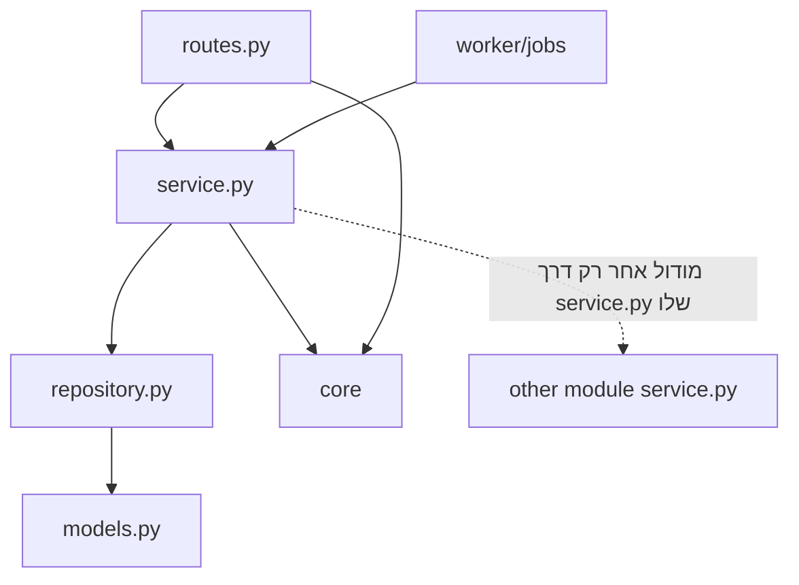

# Architecture Spine: CartWise

> המסמך המלא, עם הנימוקים, האלגוריתמים ותוכנית הבדיקות: [architecture.md](architecture.md).
> ההחלטות בקובץ הזה מחייבות. אם יש סתירה, הקובץ הזה קובע.

## Design Paradigm

**Modular monolith, layered** (עודכן 2026-10-28).
- **קוד אחד** משמש גם את ה-API וגם את ה-worker.
- **מודולים לפי תחום.** בכל מודול יש ארבע שכבות פשוטות: `routes` ← `service` ← `repository` ← `models`.
- **הצינורות** (קליטת קבצים, עיבוד חשבונית) הם רצף של פונקציות ב-`service`, שה-worker מריץ.

```
backend/app/
  core/                      # config, db, auth Subject, errors, money, ids
  modules/<module>/          # identity, lists, catalog, pricing, ingestion, receipts, matching, trust, quota, spending, geo
    models.py  schemas.py  repository.py  service.py  routes.py
  worker/                    # APScheduler + jobs-table consumer
mobile/                      # Expo app (TypeScript), Android in MVP
deploy/                      # docker-compose.yml, Caddyfile, backup.sh
```



## Invariants & Rules

### AD-1: מבנה המערכת והסטאק [ADOPTED]
- **Binds:** all
- **Prevents:** בחירות סטאק שונות במודולים שונים, ושירותים שנוספים בלי צורך.
- **Rule:**
  - **אפליקציה:** React Native ו-Expo SDK 56, ב-TypeScript. Android בלבד ב-MVP.
  - **Backend:** Python 3.13 ומעלה ו-FastAPI.
  - **מסד נתונים:** PostgreSQL 16, עם PostGIS, pg_trgm ו-unaccent.
  - **שרת:** כל הרכיבים רצים כ-Docker Compose על שרת אחד: Oracle Cloud Always Free באזור ירושלים (il-jerusalem-1). הקונטיינרים הם `caddy`, `api`, `worker` ו-`db`.
  - **שירותים חיצוניים:** רק Firebase Auth, openrouteservice ו-Sentry.
  - **אין שירות נוסף** בלי שאחד מספי ההרחבה ב-architecture §12 נחצה.

### AD-2: גבולות בין מודולים
- **Binds:** all backend modules
- **Prevents:** מודול שקורא או כותב ישירות לטבלאות של מודול אחר.
- **Rule:**
  - כל טבלה שייכת למודול אחד, ומוגדרת ב-`models.py` שלו (ראו טבלת הבעלות).
  - רק ה-`repository.py` של המודול הבעלים ניגש לטבלה.
  - מודול אחר משתמש בנתונים רק דרך `service.py` של המודול הבעלים.
  - `routes.py` לא ניגש ישירות ל-repository.

| בעלים | טבלאות |
|---|---|
| identity | users, devices, user_clubs, user_brands, user_prefs |
| lists | shopping_lists, list_items |
| catalog | chains, clubs, stores, brands, categories, products, product_aliases |
| pricing | price_observations, promotions, promotion_products, stock_reports |
| ingestion | ingestion_runs, ingestion_files |
| receipts | receipts, receipt_lines |
| matching | match_candidates, match_votes |
| trust | user_trust, observation_reviews, blocks |
| quota | quota_ledger |
| spending | (views over receipts and receipt_lines; owns no tables) |
| geo | travel_time_cache |
| core (worker) | jobs |

### AD-3: תצפית מחיר היא רשומה שלא משתנה, והמצב נגזר
- **Binds:** pricing, ingestion, receipts, trust, E3, E5, E7
- **Prevents:** עדכון מחיר "במקום" ואובדן היסטוריה. שני מסלולים שכותבים מחיר.
- **Rule:**
  - כל מחיר נכתב כשורה חדשה ב-`price_observations`, עם `source` (official_file או receipt), `price_type` (regular, promo או club) ו-`status` (valid, conflicting, pending_branch או rejected).
  - אין UPDATE למחיר. רק `status` משתנה, ורק דרך `pricing.service` → `trust`.
  - "המחיר הנוכחי" הוא שאילתה או materialized view, ולא עמודה.

### AD-4: כללי העדיפות והאמינות נמצאים במקום אחד
- **Binds:** FR-42..FR-45, pricing, trust
- **Prevents:** חישובי אמינות או עדיפות שונים בהשוואה, בפירוט ובסריקה.
- **Rule:**
  - הפונקציות `trust.service.resolve_effective_observation()` ו-`trust.service.reliability_level()` הן המקור היחיד לכללי העדיפות ולרמות האמינות.
  - כל הספים נמצאים ב-`trust.config`.
  - אף מודול אחר לא מחשב צבע אמינות.

### AD-5: חישוב הסל רץ רק בשרת
- **Binds:** FR-18..FR-25, FR-47..FR-49, pricing, quota
- **Prevents:** חישוב באפליקציה שעוקף את המכסה, או חושף את המאגר לגירוד.
- **Rule:**
  - `POST /v1/comparisons` הוא המקום היחיד שמחשב את הסל.
  - ניכוי המכסה וחישוב הסל מתבצעים באותה טרנזקציה לוגית, בדרך הזאת:
    1. שמירה (reservation) של השוואה מהמכסה.
    2. חישוב הסל.
    3. אם החישוב הצליח, אישור הניכוי (commit).
    4. אם החישוב נכשל או שאין מספיק נתונים, החזרת ההשוואה למכסה (release).
  - האפליקציה רק מציגה את התוצאה.

### AD-6: מחיר אפקטיבי הוא פונקציה טהורה
- **Binds:** FR-19, pricing.domain
- **Prevents:** חישובי מבצעים שונים בין ההשוואה לפירוט החנות.
- **Rule:**
  - הפונקציה `pricing.service.effective_price(item, observations, promotions, user_clubs, qty) -> PriceQuote` היא היחידה שמחשבת מחיר.
  - גם `/comparisons` וגם `/comparisons/:id/stores/:store_id` משתמשים בתוצאה השמורה שלה, ולא מחשבים מחדש.

### AD-7: תמונת חשבונית לא נשמרת ולא יוצאת מהשרת
- **Binds:** FR-26..FR-30, NFR-11, receipts
- **Prevents:** כתיבה של תמונה לדיסק, לבסיס נתונים, לגיבוי או ללוג, או שליחה שלה לשירות חיצוני.
- **Rule:**
  - התמונה קיימת רק בזיכרון של בקשת `POST /v1/receipts`, בזמן שה-OCR המקומי רץ (Tesseract ו-OpenCV, בתוך התהליך).
  - התמונה לא נשלחת לאף שירות חיצוני.
  - אסור ל-logger לתעד את גוף הבקשה בנתיב הזה.
  - בכל כשל, הבקשה מסתיימת, והתמונה משתחררת מהזיכרון.

### AD-8: טשטוש במכשיר, וניקוי טקסט בשרת
- **Binds:** FR-27, FR-28, receipts, mobile
- **Prevents:** מידע מזהה שמגיע לשרת, או נשמר במאגר.
- **Rule:**
  - **במכשיר:** זיהוי של תבניות ספרות עם ML Kit (כרטיס, טלפון, מועדון, אישור), טשטוש של כל השורה, ואישור של המשתמש לפני שליחה.
  - **בשרת:** `receipts.service.scrub_pii()` רץ על כל טקסט שה-OCR החזיר, לפני ה-parser ולפני כל שמירה.

### AD-9: התאמת מוצרים רק דרך מודול matching
- **Binds:** FR-17, FR-37..FR-41, ingestion, receipts
- **Prevents:** קליטת קבצים וסריקת חשבוניות שיוצרות מוצרים כפולים בדרכים שונות.
- **Rule:**
  - כל כינוי, מקובץ או מחשבונית, עובר דרך `matching.service.match(alias, chain_id, context) -> MatchResult`. התוצאה היא certain, uncertain או new_product_proposal, עם ציון ביטחון.
  - רק matching יוצר שורות ב-`product_aliases`.
  - רק catalog יוצר מוצרים, ורק לבקשת matching או לבקשת מפעיל.

### AD-10: זמני נסיעה רק דרך geo.service, עם מטמון
- **Binds:** FR-18, NFR-26, geo
- **Prevents:** קריאות ל-openrouteservice מכמה מקומות, וחריגה מהמכסה החינמית (500 בקשות matrix ביום).
- **Rule:**
  - `geo.service.travel_times(origin, store_ids, mode)` היא הנקודה היחידה שקוראת ל-ORS.
  - אמצעי התחבורה ב-MVP: `walk` או `car`.
  - **סדר הפעולות:**
    1. סינון לפי מרחק אווירי.
    2. חיפוש במטמון, לפי geohash של נקודת המוצא (דיוק 7), חנות ואמצעי תחבורה.
    3. בקשת matrix אחת לכל הסניפים שחסרים במטמון.
  - **מונה יומי:** כשהמונה מגיע ל-450 בקשות, ההשוואה עוברת להערכת זמן לפי מרחק אווירי, וזה מסומן בתוצאה.
  - מיקום המשתמש לא נשמר, רק ה-geohash במטמון (NFR-12).

### AD-11: מכסה כספר תנועות
- **Binds:** FR-47..FR-49, quota
- **Prevents:** מונה מכסה שמשתבש בעדכונים מקבילים, או אובדן של יתרת סריקות.
- **Rule:**
  - `quota_ledger` הוא append-only: grant_monthly, grant_scan, reserve, commit או release.
  - היתרה היא סכום של שורות הספר.
  - המפתח הוא subject_id, כלומר user_id, או device_id אצל משתמש אורח.
  - בהרשמה, השורות של המכשיר עוברות ל-user_id.

### AD-12: זהות ואורחים
- **Binds:** FR-1, FR-2, identity, all endpoints
- **Prevents:** endpoints שמזהים משתמש בדרכים שונות.
- **Rule:**
  - כל בקשה מגיעה עם Firebase ID token (משתמש רשום, Google) או עם device token (אורח), יחד עם אימות Firebase App Check (Play Integrity).
  - `core.auth.Subject` הוא המקור היחיד לזהות בצד השרת.
  - נשמר רק `firebase_uid`. בלי שם ובלי מייל.
  - Apple Sign-in ו-App Attest יתווספו עם iOS.

### AD-13: ממשק API ופורמט שגיאות
- **Binds:** all endpoints, mobile
- **Prevents:** תגובות, תאריכים או כסף בפורמטים שונים.
- **Rule:**
  - REST/JSON תחת `/v1`.
  - כסף נשמר כמספר שלם באגורות (`amount_agorot`).
  - זמנים בפורמט ISO-8601 UTC.
  - מזהים הם UUIDv7.
  - שגיאה בפורמט `{"error": {"code", "message_he", "details"}}`.
  - OpenAPI מיוצר מ-FastAPI, ולקוח TypeScript נוצר ממנו. אין טיפוסים שנכתבים ידנית באפליקציה.

### AD-14: שלבי הצינורות הם idempotent
- **Binds:** ingestion, receipts, workers
- **Prevents:** תצפיות כפולות כשריצה חוזרת על עצמה.
- **Rule:**
  - **קובץ רשמי:** מזוהה לפי `(chain_id, file_name, file_hash)`. קובץ שכבר נקלט מדולג.
  - **חשבונית:** מזוהה לפי fingerprint, כלומר `sha256(store|datetime|total|receipt_no)` (FR-34).

## Consistency Conventions

| נושא | כלל |
|---|---|
| שמות | טבלאות ועמודות ב-snake_case ובאנגלית. מודולים בלשון יחיד. endpoints ברבים. מונחי המילון ב-PRD §3 ממופים לשמות קבועים: תצפית מחיר = `price_observation`, סניף = `store`, רשת = `chain`, כינוי = `alias`. |
| טקסט בעברית | נשמר ב-Unicode NFC. לחיפוש יש עמודה `name_norm`, שעוברת דרך `catalog.service.normalize_he()` (הסרת ניקוד, איחוד כתיב). |
| מיקום | `geography(Point, 4326)`. |
| זמן | `timestamptz` ב-UTC. התצוגה באזור הזמן Asia/Jerusalem נעשית רק באפליקציה. |
| לוגים | JSON מובנה עם `request_id` ו-`subject_hash`. בלי גוף בקשה, בלי תמונה, בלי מיקום. |
| קונפיגורציה | ספים מספריים (FR-20, FR-39, FR-43, FR-44, FR-47) ב-`config/thresholds.yaml`, ונטענים במודול הבעלים. |
| ריפו ציבורי | אין סודות, מפתחות, `.env`, קבלות אמיתיות או נתוני משתמשים בריפו. סודות נשמרים ב-GitHub Secrets או ב-`.env` בשרת. gitleaks חוסם merge |
| UI באפליקציה | הטוקנים מ-DESIGN.md נמצאים ב-`mobile/src/theme/tokens.ts`. RTL מאולץ (`I18nManager.forceRTL`). מחרוזות ב-`he.json`. |

## Deferred

אלה החלטות שלא נקבעות כאן, וייסגרו בשלבים מאוחרים יותר:
- **embeddings להתאמה:** pgvector. ייבחר לפי ניסוי על מדגם (S4.2).
- **שיפור החילוץ, אם ה-OCR המקומי לא יספיק (SM-2):** מודל ראייה בקוד פתוח על השרת, או שירות בתשלום. החלפה כזו דורשת עדכון של AD-7.
- **הרחבה מעבר לשרת אחד:** ORS בהתקנה עצמית, הפרדת Postgres, או שירותים מנוהלים. לפי הספים ב-architecture §12.
- **iOS:** Apple Sign-in, App Attest ו-VoiceOver, בגרסה 1.1.
- **תחבורה ציבורית:** בגרסה 1.1. דורשת ספק או OpenTripPlanner עם GTFS של ישראל.
- **סביבת staging נפרדת,** ו-Infrastructure-as-code.
- **כלי הניהול (FR-41, FR-46):** ב-MVP, endpoints מוגנים ו-UI מינימלי.
