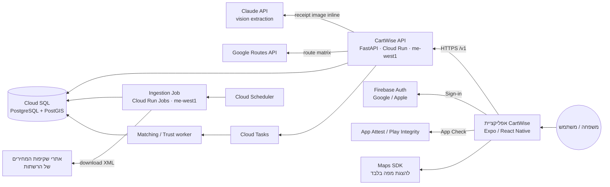
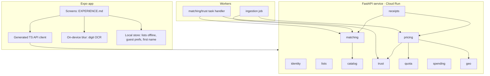
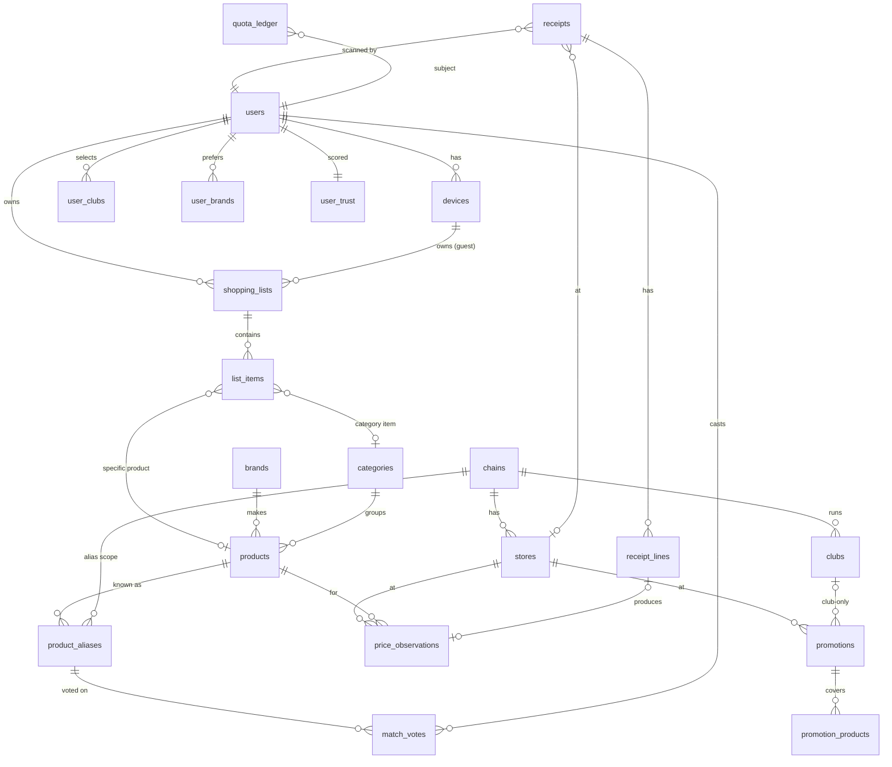
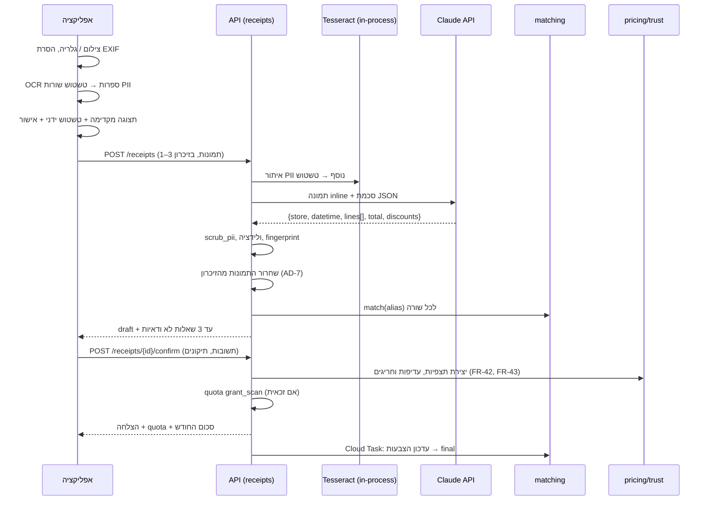
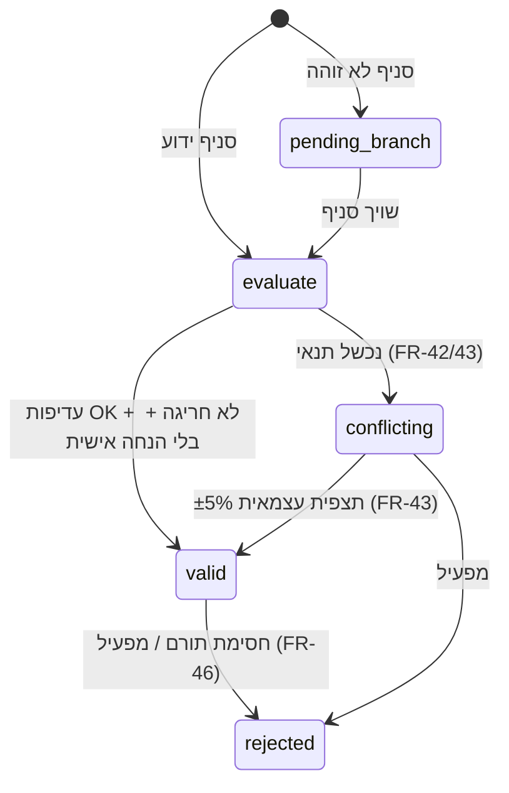

# CartWise: מסמך ארכיטקטורה

> **איך המסמך בנוי:**
> - **מחייב:** ההחלטות ב-[ARCHITECTURE-SPINE.md](ARCHITECTURE-SPINE.md) (מסומנות AD-n).
> - **מסביר:** המסמך הזה. הוא נותן את הנימוקים, את פירוט האלגוריתמים ואת תוכנית הבדיקות.
> - **הפניות:** FR, NFR ו-EC מתייחסים ל-[PRD](../../prds/prd-CartWise-2026-10-26/prd.md).
> - **הנחות:** מסומנות `[הנחה]` או `[לאמת]`.

## 1. סקירה



**שלושה זרמים עיקריים:**
1. **קליטה:** קובצי המחירים של הרשתות נקלטים כל כמה שעות לבסיס הנתונים.
2. **השוואה:** סינכרונית. האפליקציה שולחת בקשה, והשרת מחשב ומחזיר תשובה תוך 3 שניות.
3. **סריקה:** סינכרונית עד מסך האישור, תוך 15 שניות. ההתאמה הסופית ועדכון האמינות רצים אחר כך, באופן אסינכרוני.

## 2. סטאק טכנולוגי ונימוקים

| שכבה | בחירה | למה | חלופה שנשקלה | סטטוס |
|---|---|---|---|---|
| אפליקציה | **React Native + Expo SDK 56** (RN 0.85, React 19.2), TypeScript ([expo.dev](https://expo.dev/sdk/56)) | iOS ו-Android מקוד אחד, ספריות בשלות למצלמה, מפות, סריקת ברקוד ו-RTL, ופתח לאתר בעתיד. בניית האפליקציות ב-EAS. | Flutter | נבחר |
| מצלמה ו-OCR במכשיר | `expo-camera` לצילום ולסריקת ברקוד, ומודול native ל-OCR של ספרות (ML Kit Text Recognition או Apple Vision) דרך Expo dev client | נדרש לזיהוי תבניות ספרות לטשטוש (AD-8). ML Kit לא מזהה כתב עברי, אבל ספרות כן `[לאמת]` | שליחת התמונה בלי טשטוש, נדחה בגלל פרטיות | נבחר |
| מפות באפליקציה | `react-native-maps` | הצגת סיכות בלבד. לא משמש לחישוב זמני נסיעה | Mapbox | `[הנחה]` |
| Backend | **Python 3.13+, FastAPI** (≥0.118.3, שתומך גם ב-Python 3.14), Pydantic v2, SQLAlchemy 2 ו-Alembic | הצוות מכיר Python. ספריית קליטת הקבצים (`il-supermarket-scraper`) כתובה ב-Python. FastAPI מייצר OpenAPI אוטומטית (AD-13). | Java + Spring | נבחר. הגרסאות ננעלות בזמן הבנייה |
| הרצה | **Cloud Run** (API) ו-**Cloud Run Jobs** (קליטה) ב-**me-west1** | Serverless, משלמים לפי שימוש, ושרת בישראל, כי חלק מאתרי הרשתות חוסמים גישה מחו"ל. | GKE, VM | `[לאמת]`: זמינות ב-me-west1 |
| בסיס נתונים | **Cloud SQL for PostgreSQL**, עם PostGIS, pg_trgm ו-unaccent | שאילתות מיקום (ST_DWithin), חיפוש fuzzy בעברית, וטרנזקציות למכסה. | Firestore, נדחה כי אין בו שאילתות מיקום ו-SQL | `[לאמת]`: הרחבות זמינות |
| תורים | **Cloud Tasks** ו-**Cloud Scheduler** | משימות רקע להתאמה ולאמינות, וקליטה מתוזמנת | Pub/Sub | נבחר |
| הזדהות | **Firebase Auth** (Google ו-Apple), ו-**Firebase App Check** | הרשמה רק כשצריך (FR-2), ואימות שהבקשה מגיעה מהאפליקציה האמיתית (גם לאורחים) | Auth0, Supabase Auth | נבחר |
| חילוץ חשבוניות | **Claude API** (vision), עם תמונה inline ופלט JSON לפי סכמה | עובד טוב עם עברית ועם קיצורים, ומחזיר שדות מובנים. דגם: Claude Sonnet 5.5, עם בדיקה של Haiku 5.5 להוזלה `[הנחה: הבחירה הסופית לפי מדגם]` | Google Document AI ו-parser | נבחר |
| OCR בשרת לטשטוש | **Tesseract 5** (heb ו-eng), בתוך התהליך | שלב טשטוש שני בלי ספק חיצוני (AD-8) | Cloud Vision | נבחר |
| זמני נסיעה | **Google Routes API**, `computeRouteMatrix` (WALK, DRIVE, TRANSIT) ([Google](https://developers.google.com/maps/documentation/routes/transit-rm)) | אמין, ותומך בתחבורה ציבורית. התשלום לפי זוג מוצא-יעד, ועד 100 זוגות בבקשה בתחבורה ציבורית. | OSRM + OpenTripPlanner | נבחר. `[לאמת]`: איכות הנתונים והעלות בישראל |
| קליטת קבצים | [`il-supermarket-scraper`](https://pypi.org/project/il-supermarket-scraper/1.0.6/) כבסיס, עם adapter נפרד לכל רשת | ספרייה שמתוחזקת ונבדקת כל יום, ומכסה את הרשתות שברשימה הממשלתית | כתיבה מאפס | `[לאמת ב-S3.1]`: רישיון ויציבות |
| CI/CD | GitHub Actions, Cloud Build, ו-EAS Build/Submit | | | `[הנחה]` |
| ניטור | Cloud Logging, Cloud Monitoring ו-Error Reporting. Sentry לאפליקציה | | | `[הנחה]` |

## 3. רכיבים



| מודול | תפקיד | FR |
|---|---|---|
| identity | משתמשים, מכשירים, אורחים, מועדונים, מותגים רצויים, העדפות, מחיקת חשבון | FR-1..FR-7 |
| lists | רשימות ופריטים | FR-8..FR-12 |
| catalog | רשתות, מועדונים, סניפים, מוצרים, מותגים, קטגוריות, חיפוש | FR-9, FR-10, FR-14, FR-41 |
| ingestion | הורדה ועיבוד של קבצים רשמיים, וניטור | FR-13..FR-16 |
| pricing | תצפיות, מבצעים, מחיר אפקטיבי, השוואת סל, דיווח מלאי | FR-15, FR-18..FR-25 |
| receipts | צינור הסריקה, חשבונית כפולה או ישנה, מגבלות | FR-26..FR-36 |
| matching | התאמת כינויים, הצבעות, התאמה סופית | FR-17, FR-37..FR-41 |
| trust | עדיפות, חריגים, אמינות, ציון משתמש, חסימה | FR-42..FR-46 |
| quota | ספר המכסה | FR-25, FR-47..FR-49 |
| spending | סיכומי הוצאות | FR-50, FR-51 |
| geo | זמני נסיעה ומטמון | FR-18, NFR-26 |

## 4. מודל נתונים



### 4.1 טבלאות מרכזיות

| טבלה | שדות עיקריים | הערות |
|---|---|---|
| `users` | id, firebase_uid (unique), email, created_at, deleted_at | בלי שם, טלפון או כתובת (FR-2) |
| `devices` | id, user_id (nullable), install_id_hash, attestation_ok_at | זהות לאורח (FR-1) |
| `user_clubs` / `user_brands` | subject_id, club_id / brand_id | subject הוא user או device |
| `user_prefs` | subject_id, default_mode, default_minutes, min_coverage_pct | FR-5, FR-20 |
| `chains` | id, name, gov_chain_code, publishes_files | חנות עצמאית היא chain עם סניף אחד |
| `clubs` | id, chain_id, name | |
| `stores` | id, chain_id, gov_store_code, name, address, location `geography(Point)`, source (official, user_added), status | אינדקס GIST על location (FR-14, FR-31) |
| `brands` | id, name, name_norm | |
| `categories` | id, parent_id, name | FR-50 |
| `products` | id, barcode (unique, nullable), name, name_norm, brand_id, category_id, pack_size, pack_unit (unit, g, kg, ml, l), is_weighted, status (active, proposed, merged_into) | אינדקס trigram על name_norm (FR-9) |
| `product_aliases` | id, chain_id, alias_text, alias_norm, barcode, product_id, state (certain, uncertain, final, disputed), confidence | unique על (chain_id, alias_norm, barcode). AD-9 |
| `price_observations` | id, product_id, store_id (nullable עד שיוך סניף), chain_id, source (official_file, receipt), price_type (regular, promo, club), unit_price_agorot, per (unit, kg), observed_at, source_ref (file id או receipt_line id), contributor_user_id (nullable), status (valid, conflicting, pending_branch, rejected), has_personal_discount | append-only (AD-3). מחולק לפי חודש. אינדקס על (store_id, product_id, observed_at desc) |
| `promotions` | id, chain_id, store_id, club_id (nullable), kind (fixed_price, multi_buy, percent), min_qty, bundle_price_agorot, percent, starts_at, ends_at, source | FR-15, EC-3 |
| `promotion_products` | promotion_id, product_id | |
| `stock_reports` | store_id, product_id, reported_at, subject_hash | FR-24. תוקף 48 שעות |
| `shopping_lists` | id, owner_subject_id, name, is_standing, updated_at | |
| `list_items` | id, list_id, product_id or category_id + pack_size/unit, qty, unit, brand_constraint (specific, preferred, any) | FR-11. pack_size חובה בפריט קטגוריה, וזה הסינון לפי גודל אריזה |
| `receipts` | id, user_id, store_id (nullable), chain_id, purchased_at, total_agorot, fingerprint (unique), status (confirmed, partial, spend_only, rejected), credited (bool) | בלי תמונה (AD-7) |
| `receipt_lines` | id, receipt_id, raw_text (אחרי scrub), barcode, qty, weight_kg, unit_price_agorot, line_total_agorot, is_return, has_personal_discount, alias_id | |
| `match_votes` | alias_id, user_id, product_id, vote (confirm, other, unknown), created_at | FR-39 |
| `user_trust` | user_id, accepted_count, anomalous_count, score, blocked | FR-45, FR-46 |
| `quota_ledger` | id, subject_id, kind (grant_monthly, grant_scan, reserve, commit, release), amount, period (YYYY-MM), ref_id, created_at | AD-11 |
| `travel_time_cache` | origin_geohash7, store_id, mode, time_bucket, seconds, fetched_at | TTL של 7 ימים לרכב והליכה, ושל יום אחד לתחבורה ציבורית `[הנחה]` |
| `ingestion_runs` / `ingestion_files` | chain_id, started_at, status, file_name, file_hash, records, errors | FR-13, FR-16, AD-14 |

### 4.2 "המחיר הנוכחי"

הנתון הזה הוא materialized view בשם `current_prices`. הוא מכיל, לכל (store_id, product_id, price_type), את התצפית התקפה האחרונה, יחד עם `reliability_level`. ה-view מתרענן:
- אחרי כל ריצת קליטה
- אחרי אישור של חשבונית
- אחרי שינוי סטטוס של תצפית

## 5. מבנה ה-API

**כללים כלליים:**
- **בסיס:** `https://api.cartwise.app/v1`.
- **הזדהות:** כותרת `Authorization: Bearer <firebase_id_token | device_token>`, וכותרת `X-Firebase-AppCheck`.
- **פורמטים:** לפי AD-13.

| Method | Path | תיאור | FR |
|---|---|---|---|
| POST | /devices | רישום מכשיר אורח, והחזרת device_token | FR-1 |
| POST | /auth/link | קישור מכשיר למשתמש אחרי התחברות ב-Firebase (העברת רשימות, העדפות ומכסה) | FR-2 |
| DELETE | /me | מחיקת חשבון | FR-6 |
| GET/PUT | /me/prefs, /me/clubs, /me/brands | העדפות | FR-3..FR-5 |
| GET | /chains, /clubs | רשתות ומועדונים שנתמכים | FR-3 |
| GET | /products/search?q= | חיפוש עם תוצאות מ-2 תווים | FR-9 |
| GET | /products/by-barcode/{code} | חיפוש לפי ברקוד | FR-10 |
| GET | /brands/search?q= | חיפוש מותגים | FR-4 |
| CRUD | /lists, /lists/{id}/items | רשימות | FR-8, FR-11, FR-12 |
| POST | /comparisons | גוף הבקשה: `{list_snapshot, origin{lat,lng}, mode, max_minutes, min_coverage_pct}`. מחזיר דירוג חנויות ו-quota_remaining | FR-18..FR-25 |
| GET | /comparisons/{id} | תוצאה שמורה (מסך הבית, "ההשוואה האחרונה") | UX §10.2 |
| GET | /comparisons/{id}/stores/{store_id} | פירוט לפי פריט | FR-21 |
| GET | /observations/{id}/reliability | פירוט אמינות | FR-22 |
| POST | /stock-reports | דיווח "לא היה במלאי" | FR-24 |
| GET | /quota | יתרה | FR-49 |
| POST | /receipts | multipart: עד 3 תמונות מטושטשות. סינכרוני. מחזיר draft: חנות, תאריך, שורות ועד 3 שאלות. או שגיאה: unreadable, duplicate, too_old, future, daily_limit | FR-26..FR-36 |
| POST | /receipts/{id}/branch | שיוך סניף או חנות חדשה | FR-31 |
| POST | /receipts/{id}/confirm | גוף הבקשה: תיקונים ותשובות התאמה. יוצר תצפיות, הצבעות וזיכוי מכסה | FR-32, FR-48 |
| GET | /spending?month= | סיכום | FR-50 |
| GET/DELETE | /receipts/{id} | פירוט ומחיקה מהסיכום | FR-51 |
| — | /admin/* | התאמות במחלוקת, מיזוג מוצרים, חסימה. נגיש רק בהרשאת operator | FR-41, FR-46 |

**הגבלת קצב (NFR-10):** לכל subject, 30 בקשות `/comparisons` לשעה, 60 בקשות `/products/search` לדקה, ו-10 בקשות `/receipts` ליום. `[הנחה]`

## 6. קליטת קובצי מחירים רשמיים

```mermaid
graph RL
  s[Cloud Scheduler<br/>כל 6 שעות לכל רשת] --> j[Ingestion Job · me-west1]
  j --> f1[Fetch: adapter לכל רשת<br/>il-supermarket-scraper]
  f1 --> f2[Dedup: file_hash<br/>AD-14]
  f2 --> f3[Parse XML → רשומות<br/>stores / prices / promos]
  f3 --> f4[Normalize: יחידות, אגורות,<br/>normalize_he]
  f4 --> f5[Match: barcode → product,<br/>אחרת matching.service]
  f5 --> f6[Write: price_observations<br/>source=official_file]
  f6 --> f7[Refresh current_prices]
  f7 --> f8[Health metrics → התראות FR-16]
```



**כללים:**
- **Adapter לכל רשת:** כל adapter מממש את `ChainFeedPort.list_files()` ואת `fetch(file)`. שינוי בפורמט של רשת אחת לא שובר את האחרות.
- **סניפים:** קובץ סניפים יוצר או מעדכן `stores`. כשחסרות קואורדינטות, המערכת משתמשת ב-geocoding של Google לפי הכתובת. סניף שה-geocoding נכשל עבורו מקבל `status=needs_location` ולא נכנס להשוואות (FR-14).
- **מבצעים:**
  - נשמרים עם תוקף, תנאי כמות וסוג.
  - מבצע שלא מתועד בבירור כפתוח לכולם נשמר עם `club_id` של מועדון הרשת (FR-15).
  - ⚠️ זה תלוי באימות A3 ב-S3.1.
- **התראות (FR-16):** בשלושה מקרים:
  - רשת שלא נקלטה במשך יותר מ-24 שעות
  - ירידה של יותר מ-30% במספר הרשומות
  - יותר מ-5% שגיאות parsing
- **מוצרים בלי ברקוד** בקובץ (למשל ירקות במשקל): עוברים דרך matching, באותו מסלול כמו כינוי מחשבונית.

## 7. צינור עיבוד חשבוניות



**שלבים וכללים:**

1. **ולידציה של התוצאה מה-LLM:**
   - חנות ותאריך: חובה.
   - סכום השורות צריך להתאים לסכום הכולל, עם סטייה של עד ±2%.
   - אם פחות מ-50% מהשורות קריאות, החשבונית מסווגת כ-`unreadable` (FR-33).
   - שורות עם סכום שלילי מסומנות `is_return` (EC-5).
   - הנחה שמופיעה מתחת לשורה משויכת לשורה שמעליה.
   - קופון או הנחה כללית על כל החשבונית מסומנים `has_personal_discount` (EC-9).
   - **סיווג הנחות (FR-29, EC-21):** הסכמה שה-LLM ממלא כוללת לכל הנחה את השדה `discount_kind`, עם אחד מהערכים `club`, `multi_buy`, `percent`, `personal` או `unknown`. אחר כך `receipts.domain.classify_discount()` מאמת את הסיווג בכללים: מילון של מילים כמו "מועדון" ושמות המועדונים, ו-regex לתבניות כמו "N ב-X".
     - `club`: נוצרות שתי תצפיות, `regular` ו-`club` (עם club_id של הרשת).
     - `multi_buy` או `percent`: נוצרות תצפית `regular` ושורה ב-`promotions` (source=receipt, ends_at = purchased_at + 7d).
     - `unknown`: נוצרת רק תצפית `regular`.
2. **בדיקות חשבונית:**
   - **כפולה:** לפי fingerprint (FR-34).
   - **תאריך:** חשבונית מלפני יותר מ-30 יום מקבלת `spend_only`. חשבונית עם תאריך עתידי נדחית (FR-35).
   - **מגבלה יומית:** אחרי 5 זיכויים ביום, החשבונית מסומנת `credited=false` (FR-36).
3. **מוצר שקיל:** אם יש שורת משקל (למשל "1.240 ק"ג"), נשמר מחיר לק"ג (EC-2).
4. **זיהוי סניף:**
   - קודם לפי קוד הסניף או הכתובת שבחשבונית.
   - אחר כך לפי שם הרשת וסניפים בטווח של 2 ק"מ מנקודה שהמשתמש בחר. מיקום אוטומטי לא נשלח.
   - אם לא נמצא סניף, החשבונית מקבלת `pending_branch` (FR-31).
5. **טיוטה בין השלבים:** בין `POST /receipts` ל-`/confirm` הטיוטה נשמרת כ-`receipts.status=draft`, בלי תמונה. טיוטה שלא אושרה תוך 24 שעות נמחקת.
6. **ה-prompt למודל:** כולל הנחיה מפורשת לא להחזיר פרטים מזהים, ופלט JSON לפי סכמה. אחרי החילוץ, `scrub_pii` רץ בכל מקרה.
7. **שמירת נתונים אצל הספק (Q1, הוחלט B):** הספק מקבל רק תמונה שטושטשה פעמיים, ועשוי לשמור אותה זמנית לפי המדיניות שלו. במקביל מגישים בקשה ל-Zero Data Retention ב-Anthropic, ומדיניות הפרטיות מציינת את השמירה הזמנית. ZDR ניתן לכל ארגון בנפרד, ובאישור. גם עם ZDR, Files API נשמר, ולכן לא משתמשים בו ([Anthropic](https://platform.claude.com/docs/en/manage-claude/api-and-data-retention)). ראו שאלה פתוחה Q1 בסעיף 16.

## 8. מנגנון התאמת מוצרים

**נרמול טקסט (`normalize_he`):**
- הסרת ניקוד, גרשיים ומרכאות
- איחוד כתיב מלא וחסר, לפי מילון קטן של וריאציות נפוצות
- פירוק קיצורים ממילון, כמו "תנ" → "תנובה" ו-"ל" → "ליטר"
- חילוץ גודל ויחידה בביטוי רגולרי, למשל "1ל", "750 מ"ל", "80ג"
- חילוץ אחוז, למשל "3%"

**דירוג מועמדים, לכינוי בלי ברקוד:**
1. **מועמדים:** עד 20 מוצרים, לפי `similarity(name_norm, alias_norm)` עם pg_trgm, בקטגוריה ובמותג שזוהו אם יש.
2. **ציון:**

   `score = 0.45·text_sim + 0.20·brand_match + 0.20·size_match + 0.10·unit_match + 0.05·price_sanity`

   `price_sanity` הוא 1 כשהמחיר נמצא בטווח ±50% מהחציון של המוצר, ו-0 אחרת. `[הנחה: המשקלים יכוילו על מדגם מתויג]`
3. **סף ודאות:** `certain` כשהציון ≥ θ, וגם הפער מהמועמד השני ≥ 0.1. θ מכויל כך ש-precision ≥ 90% (SM-1).
4. **מתחת לסף:** `uncertain`. הכינוי מוצג למשתמש, ונשמר עם 3 המועמדים הראשונים.
5. **אין מועמד מעל 0.3:** נוצרת הצעה למוצר חדש, `products.status=proposed`.

**הצבעות (FR-39):**
- התאמה הופכת ל-`final` כשיש ≥3 הצבעות confirm ממשתמשים שונים, שה-trust score של כל אחד מהם ≥ הסף.
- אם רוב ההצבעות הן לטובת מוצר אחר, הכינוי עובר ל-`disputed` ואז מתעדכן למוצר הזה.
- **זיכרון התאמות (FR-40):** הכינוי הוא ברמת הרשת, `(chain_id, alias_norm)`. בפעם הבאה שאותו כינוי מופיע באותה רשת, הוא מותאם אוטומטית.

**הרחבה בהמשך (Deferred):** embeddings עם pgvector, כרכיב נוסף בנוסחת הציון.

## 9. אלגוריתם השוואת הסל

**קלט:**
- רשימה (snapshot)
- נקודת מוצא
- אמצעי תחבורה ודקות
- סף כיסוי
- המועדונים והמותגים של המשתמש

```text
1. reserve quota (AD-5, AD-11)  — unless same list compared today (FR-25)
2. CANDIDATE STORES (geo):
     r_max = max_minutes × v_max(mode)       # walk 6 km/h, drive 60 km/h, transit 40 km/h  [הנחה]
     S0 = stores WHERE ST_DWithin(location, origin, r_max) AND status=active
3. TRAVEL TIMES (AD-10):
     for s in S0: t[s] = cache.get(geohash7(origin), s, mode, bucket(now))
     missing → Routes computeRouteMatrix in chunks of ≤100 elements → cache.put
     S = { s ∈ S0 : t[s] ≤ max_minutes }
     if S = ∅ → release quota, return NO_STORES (FR-23)
4. RESOLVE ITEMS per store s, item i:
     cand = products satisfying brand_constraint(i)           # specific / preferred brands / any (FR-11)
            with matching pack size (unit-price compare for preferred/any) (FR-19)
     for p in cand: q[p] = pricing.effective_price(i, current_prices[s,p], promos[s,p], user_clubs, qty_i)   (AD-6)
     pick p* = argmin q   (excluding status≠valid, AD-3)
     if none: known[s,i] = False
5. ESTIMATES (FR-20):
     for unknown (s,i): est = median(valid prices of chosen product over stores in S, last 30 d)
                         else median over area (10 km), else UNKNOWN
6. TOTALS:
     total[s] = Σ known q + Σ est ; est_part[s] = Σ est ; coverage[s] = |known| / |items excluding UNKNOWN-everywhere|
     reliability[s] = min level over known lines (AD-4)
7. FILTER & RANK:
     main = { s : coverage[s] ≥ min_coverage } ; partial = S \ main
     if main = ∅ → release quota, return INSUFFICIENT_DATA (FR-23)
     sort main by total asc; ties (|Δ| ≤ ₪1) → coverage desc (FR-21)
8. persist comparison snapshot (lines + quotes) → commit quota → return
```

**מחיר אפקטיבי (`effective_price`):**
- **מועמדים:** מחיר רגיל, מבצעים פעילים, ומחירי מועדון של מועדונים שהמשתמש סימן.
- **מבצע עם תנאי כמות** (`multi_buy`, למשל N ב-X): הכמות מתחלקת כך: `bundles = floor(qty / N)`, ו-`rest = qty mod N`.

  `cost = bundles·X + rest·regular`
- **מוצר שקיל:** `unit_price_per_kg × kg`.
- **הבחירה:** העלות המינימלית מבין כל המועמדים. ה-PriceQuote מחזיר גם את `price_type` ואת `promotion_id`, לתצוגה.

**סיבוכיות וביצועים:**
- **היקף:** עד 30 סניפים ו-50 פריטים, ועד 20 מועמדים לפריט. זה עד 30,000 הערכות בזיכרון.
- **שליפת נתונים:** בשאילתה אחת מ-`current_prices` לכל הסניפים והמוצרים.
- **זמני נסיעה:** כשיש פגיעה במטמון, התשובה היא מיידית. כשאין, קריאה אחת או שתיים ל-Routes, כלומר 300–800 מילישניות. `[הנחה]`
- **סיכום:** היעד של 3 שניות ב-p95 (NFR-2) ריאלי.

## 10. אמינות נתונים ומניעת הזנה זדונית

**מחזור החיים של תצפית מחשבונית:**



**שכבות ההגנה:**

| שכבה | מנגנון | FR |
|---|---|---|
| זהות האפליקציה | Firebase App Check (App Attest ו-Play Integrity) על כל בקשה, גם מאורח | NFR-10 |
| קצב | הגבלת קצב לכל subject, ומגבלת זיכוי של 5 ביום | FR-36, NFR-10 |
| כפילות | fingerprint ייחודי לחשבונית | FR-34 |
| תוכן | סכום השורות מול הסכום הכולל, תאריך, וחריגה של יותר מ-40% מהחציון | FR-35, FR-43 |
| עדיפות | שלושת התנאים של D4 | FR-42 |
| תורם | `user_trust.score = accepted / (accepted + anomalous)`. אחרי 10 תצפיות לפחות, ציון מתחת ל-0.5 מבטל לתורם את העדיפות על קובץ רשמי ואת המשקל בהצבעות | FR-45 |
| השפעה מוגבלת | תצפית אחת לא יכולה להפוך מחיר מקובץ רשמי ללא תקף. היא רק נוספת כתצפית מקבילה | AD-3 |
| ריבוי חשבונות | מכסה ואמינות קשורות גם למכשיר: device ו-attestation | FR-47 |
| מפעיל | חסימה, וסימון של כל התצפיות של התורם לבדיקה מחדש | FR-46 |

**רמת אמינות:** מחושבת ב-`trust.domain.reliability_level(source, age, confirmations, match_state)`, לפי הטבלה ב-FR-44. כשההתאמה עדיין לא סופית, הרמה המקסימלית היא צהוב (FR-39).

## 11. אבטחה ופרטיות

| נושא | יישום | NFR/FR |
|---|---|---|
| הצפנה | TLS 1.2 ומעלה בכל התקשורת. Cloud SQL מוצפן במנוחה. סודות ב-Secret Manager | NFR-8 |
| הזדהות והרשאה | Firebase ID token מאומת בשרת. device token חתום (JWT קצר מועד) לאורח. תפקיד operator מוגדר ב-custom claim | NFR-9 |
| תמונות | לא נשמרות אף פעם (AD-7). בבדיקה אוטומטית ב-CI מוודאים ש-handler של `/receipts` לא כותב לדיסק או ללוג | FR-30, NFR-11 |
| טשטוש | בשני שלבים (AD-8), ו-scrub_pii על הטקסט שחולץ | FR-27, FR-28 |
| מיקום | נשלח רק בבקשת ההשוואה. לא נשמר. במטמון נשמר geohash7 בלבד, ברדיוס של כ-150 מטרים, ובלי קישור למשתמש | NFR-12 |
| מינימום נתונים | ב-users נשמרים רק uid ו-email. השם הפרטי שמור במכשיר בלבד (UX) | FR-2 |
| אנונימיות התורמים | `contributor_user_id` לא חשוף ב-API. מחיקת חשבון מאפסת אותו ל-NULL ושומרת את התצפית | FR-6, NFR-13 |
| מחיקת חשבון | soft delete מיידי, ומחיקה קשה תוך 30 יום, ב-job יומי | FR-6 |
| לוגים | JSON בלי גוף בקשה, בלי מיקום ובלי טוקנים. `subject_hash` במקום מזהה | NFR-25 |
| ספקים חיצוניים | Claude (תמונה מטושטשת, שמירה זמנית אצל הספק, בקשה ל-ZDR), Google Routes, ו-Firebase. מסמך עיבוד נתונים לכל ספק `[לאמת משפטית]` | NFR-14 |
| שימוש לרעה | App Check והגבלת קצב. ה-API לא מאפשר להוריד את כל המאגר | NFR-10 |

## 12. סקיילביליות

**יעד ה-MVP:** כ-10 אלף משתמשים, וכ-1,000 השוואות ביום. `[הנחה]`

- **API:** Cloud Run עם autoscale. מינימום של מופע אחד בייצור, כדי למנוע cold start. כל מופע מטפל בעד 20 בקשות במקביל `[הנחה]`.
- **בסיס נתונים:**
  - `price_observations` גדלה בערך כך: 3 רשתות × כ-300 סניפים × כ-10 אלף מוצרים, ועדכון כל 6 שעות.
  - בפועל רק שינויים נשמרים, כי קובץ זהה מדולג (AD-14). צריך גם לסנן שורות בלי שינוי מחיר `[הנחה]`.
  - הטבלה מחולקת לפי חודש. אחרי 6 חודשים, הנתונים עוברים ל-archive.
- **current_prices:** materialized view עם רענון בו-זמני (refresh concurrently).
- **זמני נסיעה:** המטמון לפי geohash מוריד את מספר הקריאות ל-Routes ככל שיש יותר משתמשים באותו אזור.
- **צוואר בקבוק צפוי:** החילוץ ב-LLM. הוא סינכרוני, כ-5–12 שניות. Cloud Run מתרחב לפי concurrency, ויש timeout של 30 שניות.

## 13. פריסה וסביבות

| סביבה | פרויקט GCP | נתונים | אפליקציה |
|---|---|---|---|
| dev | cartwise-dev (me-west1) | נתוני דמה, ורשת אחת אמיתית | Expo dev client |
| staging | cartwise-staging | קליטה אמיתית מכל רשתות ה-MVP | EAS internal distribution / TestFlight |
| prod | cartwise-prod | אמיתי | App Store / Google Play |

**תהליך CI/CD:**
1. כל PR מריץ lint, type check, unit tests, eval על מדגם קטן, ובדיקות פרטיות.
2. merge ל-main בונה image ב-Cloud Build ופורס ל-staging.
3. tag פורס לייצור, אחרי אישור ידני.

**מיגרציות:** Alembic, שרץ כ-Cloud Run Job לפני הפריסה.

**אפליקציה:** EAS Build ו-EAS Update לתיקונים ב-JavaScript. שינויים ב-native עוברים בנייה מלאה.

**Infrastructure-as-code:** Deferred (ראו Spine).

## 14. תוכנית בדיקות

| סוג | כלי | מה נבדק | יעד |
|---|---|---|---|
| Unit (domain) | pytest | `effective_price` (כל מקרי EC-2, EC-3, EC-4, EC-16), `reliability_level`, `resolve_effective_observation`, `normalize_he`, `scrub_pii`, fingerprint, ספר המכסה | כיסוי של ≥90% ל-domain |
| Property-based | hypothesis | מחיר אפקטיבי אף פעם לא גבוה מהמחיר הרגיל כפול הכמות. היתרה במכסה אף פעם לא שלילית | |
| Integration | pytest ו-Postgres ב-testcontainers (עם PostGIS) | repos, שאילתות מיקום, current_prices | |
| Contract | schemathesis מול OpenAPI | שה-API תואם לסכמה ולפורמט השגיאות (AD-13) | |
| Adapters של קליטה | קבצי XML שמורים (fixtures) לכל רשת | parsing, מבצעים, סניפים | |
| Eval: התאמה | מדגם מתויג של כ-500 כינויים | SM-1 (precision ≥ 90%), כיול θ | בכל שינוי במנגנון |
| Eval: חילוץ | מדגם של כ-100 חשבוניות אמיתיות, מטושטשות ומתויגות | SM-2 (≥ 80%), השוואה בין דגמים | לפני בחירת דגם, ובכל שינוי prompt |
| פרטיות | מדגם חשבוניות עם PII סינתטי | SM-3: 0% PII אחרי טשטוש וב-DB. בדיקה סטטית שאין כתיבת תמונה או לוג | חוסם merge |
| E2E באפליקציה | Maestro | Flows 1–7 מ-EXPERIENCE.md, כולל RTL | ב-staging |
| נגישות | בדיקה ידנית עם VoiceOver ו-TalkBack, ו-axe-like lint | תקן 5568 (NFR-16..18) | לפני שחרור |
| עומס | Locust | NFR-2: 3 שניות ב-p95 על `/comparisons`, ו-NFR-3 | לפני שחרור |
| ניטור איכות בייצור | dashboard | SM-1..SM-9 (NFR-24), ובדיקה מדגמית חודשית | שוטף |

## 15. מיפוי כיסוי ה-PRD

| PRD | ארכיטקטורה |
|---|---|
| FR-1..FR-7 | identity, AD-12, §5 (/devices, /auth/link, /me), §11 |
| FR-8..FR-12 | lists, §5 |
| FR-13..FR-17 | ingestion, §6, AD-9, AD-14 |
| FR-18..FR-25 | pricing, geo, quota, §9, AD-5, AD-6, AD-10 |
| FR-26..FR-36 | receipts, §7, AD-7, AD-8, AD-14 |
| FR-37..FR-41 | matching, §8, AD-9 |
| FR-42..FR-46 | trust, §10, AD-3, AD-4 |
| FR-47..FR-49 | quota, AD-11 |
| FR-50..FR-51 | spending, §5 |
| NFR-1..NFR-4 | §9, §12, §14 (עומס) |
| NFR-5..NFR-7 | Cloud Run ו-Cloud SQL (HA בייצור `[הנחה]`). §6: השוואות על המחירים האחרונים. NFR-7: רשימות במכשיר |
| NFR-8..NFR-15 | §11 |
| NFR-16..NFR-22 | צד האפליקציה: מסמכי UX ו-tokens.ts. החיפוש (NFR-21) ב-`normalize_he` |
| NFR-23 | Expo SDK 56 (iOS ו-Android, בגרסאות שנתמכות) |
| NFR-24, NFR-25 | §13, §14, conventions בלוגים |
| NFR-26 | AD-10, מטמון, סינון אווירי |

## 16. שאלות פתוחות והנחות

| # | נושא | השפעה | מה עושים |
|---|---|---|---|
| Q1 | ✅ **הוחלט B:** השמירה הזמנית אצל הספק מתקבלת, FR-30 עודכן, ומגישים בקשה ל-ZDR. **הרקע: FR-30 מול ספק ה-LLM.** FR-30 דורש שהתמונה "לא נשמרת אצל צד שלישי". ZDR של Anthropic דורש אישור. בלי ZDR, הספק עשוי לשמור את הקלט לתקופה מוגבלת | חוסם את ההשקה, לא את הפיתוח | **החלטה שלך:** (א) להגיש בקשה ל-ZDR, ולא להשיק סריקה בלי אישור. (ב) לקבל שמירה זמנית אצל הספק של תמונה **שכבר טושטשה פעמיים**, לעדכן את FR-30 ולציין זאת במדיניות הפרטיות |
| Q2 | זמינות של Cloud Run, Cloud SQL ו-PostGIS ב-me-west1 | פריסה | אימות בקונסולה, ב-S3.1 |
| Q3 | איכות הנתונים והעלות של Routes API (TRANSIT) בישראל | FR-18, NFR-26 | ניסוי על 50 נקודות בירושלים |
| Q4 | הספרייה `il-supermarket-scraper`: רישיון ויציבות, והאם מבצעי מועדון מזוהים (A3) | E3 | ב-S3.1 |
| Q5 | OCR של ספרות במכשיר: ML Kit ו-Apple Vision דרך Expo | FR-27 | ניסוי, ב-spike של E6 |
| Q6 | מקור לקטגוריות ומותגים של מוצרים (שאלה פתוחה 5 ב-PRD) | FR-50, FR-4 | מהקבצים הרשמיים. אם חסר, תיוג ידני של הקטגוריות העיקריות |

**הנחות עיקריות:**
- המהירויות לסינון האווירי: 6, 60 ו-40 קמ"ש.
- זמן החיים של המטמון: 7 ימים, ויום אחד לתחבורה ציבורית.
- משקלי נוסחת ההתאמה.
- הגבלות הקצב.
- היקף ה-MVP: כ-10 אלף משתמשים.
- בחירת הדגם: Sonnet 5.5 לעומת Haiku 5.5.
