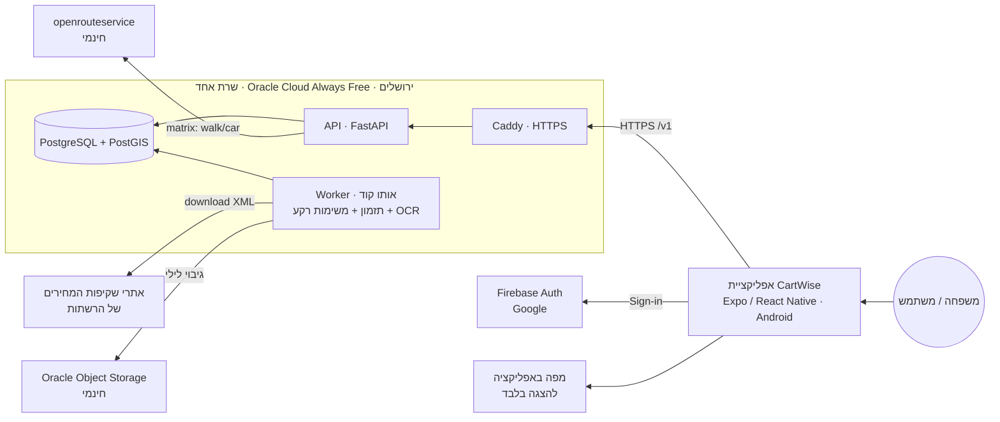
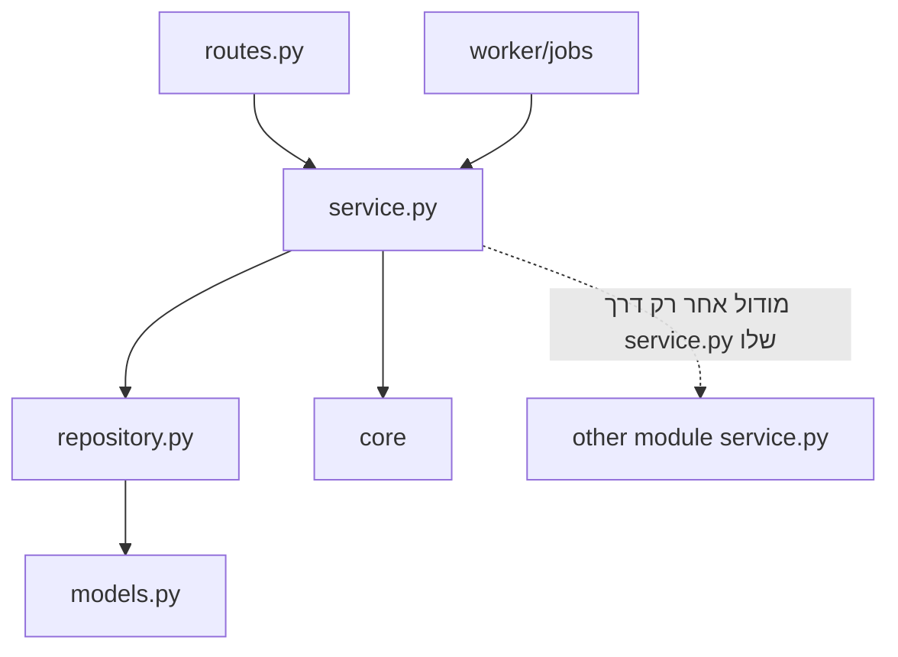
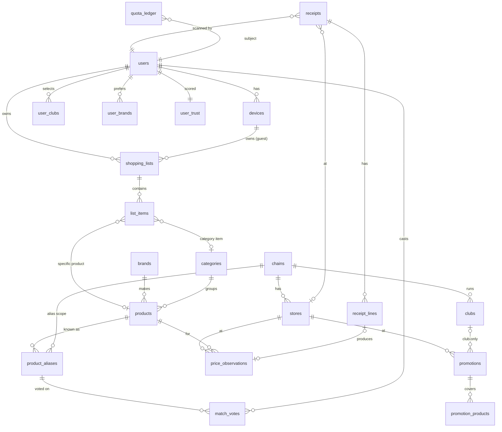
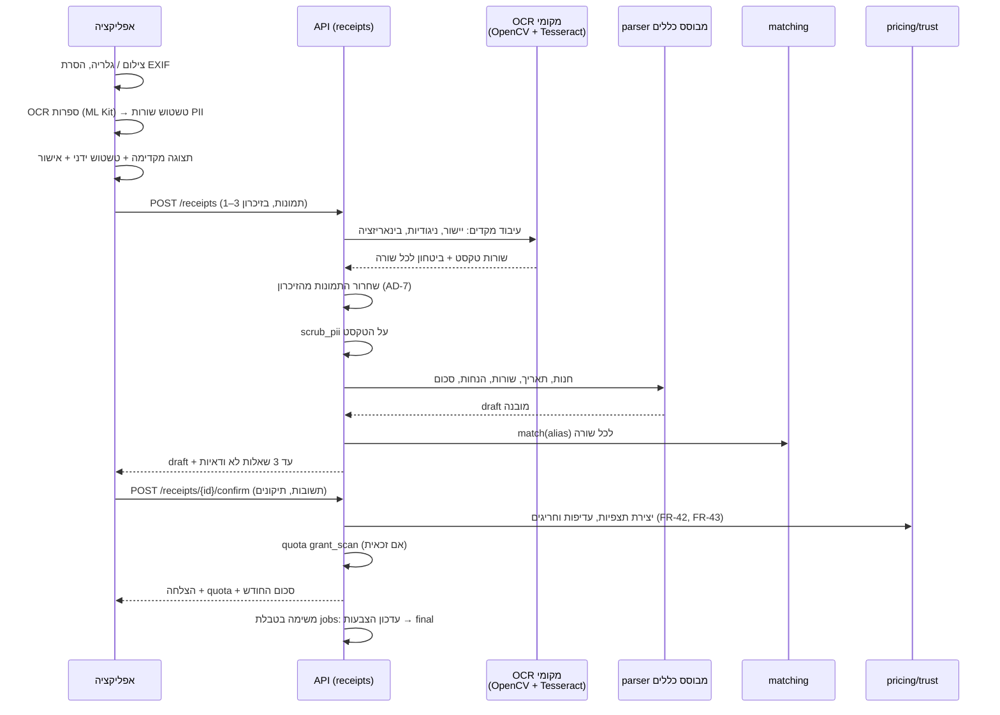
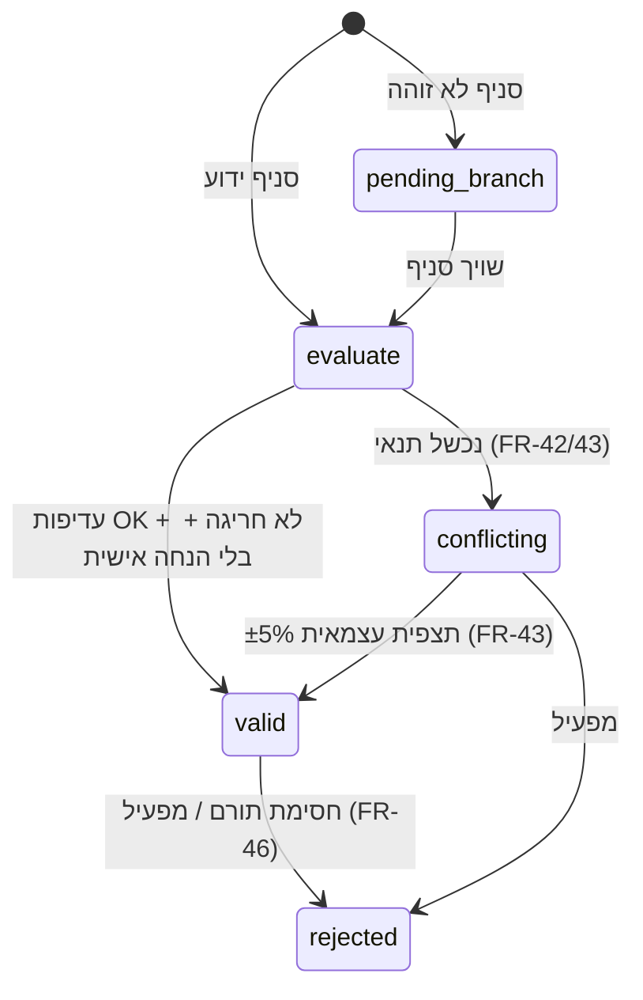

# CartWise: מסמך ארכיטקטורה

> **איך המסמך בנוי:**
> - **מחייב:** ההחלטות ב-[ARCHITECTURE-SPINE.md](ARCHITECTURE-SPINE.md) (מסומנות AD-n).
> - **מסביר:** המסמך הזה. הוא נותן את הנימוקים, את פירוט האלגוריתמים ואת תוכנית הבדיקות.
> - **הפניות:** FR, NFR ו-EC מתייחסים ל-[PRD](../../prds/prd-CartWise-2026-10-26/prd.md).
> - **הנחות:** מסומנות `[הנחה]` או `[לאמת]`.

## 1. סקירה

> **עדכון 2026-10-28:** הארכיטקטורה פושטה לשרת חינמי אחד. ה-OCR רץ אצלנו, זמני הנסיעה מגיעים משירות חינמי, וה-MVP הוא Android בלבד.



**שלושה זרמים עיקריים:**
1. **קליטה:** ה-worker מוריד את קובצי המחירים של הרשתות כל 6 שעות. ההורדה יוצאת משרת בישראל.
2. **השוואה:** סינכרונית. התשובה חוזרת תוך 3 שניות.
3. **סריקה:** ה-OCR רץ על השרת שלנו, והתמונה לא יוצאת מהשרת. ההתאמה הסופית ועדכון האמינות רצים ב-worker.

## 2. סטאק טכנולוגי ונימוקים

**עיקרון מנחה:** הכול חינמי, ושירותים מעטים ככל האפשר. מרחיבים רק כשמספר המשתמשים מחייב.

| שכבה | בחירה | למה | חלופה שנשקלה | סטטוס |
|---|---|---|---|---|
| אפליקציה | **React Native + Expo SDK 56** (RN 0.85), TypeScript ([expo.dev](https://expo.dev/sdk/56)). **MVP: Android בלבד** | קוד אחד, שיתאים גם ל-iOS בגרסה 1.1. ב-Android ההפצה חינמית (APK) או בתשלום חד-פעמי נמוך (Google Play) | Kotlin | נבחר |
| מצלמה וטשטוש במכשיר | `expo-camera` לצילום ולברקוד, ו-ML Kit Text Recognition לזיהוי ספרות, דרך Expo dev client | טשטוש של תבניות ספרות לפני השליחה (AD-8). ML Kit לא מזהה עברית, אבל ספרות כן `[לאמת]` | — | נבחר |
| מפה באפליקציה | `react-native-maps` | הצגת סיכות בלבד `[לאמת: שימוש חינמי ב-Android]` | MapLibre עם אריחי OSM | `[הנחה]` |
| שרת | **Oracle Cloud Always Free**: מכונה עם 4 ליבות ARM ו-24GB זיכרון, באזור **ירושלים** (il-jerusalem-1) ([Oracle](https://docs.oracle.com/iaas/releasenotes/changes/42075bb1-29a3-4ae2-96a1-588001665b3e)) | חינם לתמיד. השרת בישראל, ולכן הבעיה של אתרי רשתות שחוסמים גישה מחו"ל נפתרת. שרת אחד במקום 7–8 שירותים | Cloud Run + Neon | `[לאמת]`: שיש מקום פנוי בירושלים. ראו §13 לחלופה |
| הרצה | **Docker Compose** עם 4 קונטיינרים: `caddy`, `api`, `worker` ו-`db` | פשוט להקים ולתחזק. Caddy מנפיק תעודת HTTPS בחינם (Let's Encrypt) | Kubernetes | נבחר |
| Backend | **Python 3.13+, FastAPI**, Pydantic v2, SQLAlchemy 2 ו-Alembic | הצוות מכיר Python, וספריית הקליטה כתובה ב-Python | Java + Spring | נבחר |
| בסיס נתונים | **PostgreSQL 16 עם PostGIS, pg_trgm ו-unaccent**, בקונטיינר על אותו שרת | שאילתות מיקום, חיפוש fuzzy בעברית וטרנזקציות. בשרת יש עד 200GB דיסק חינמי, כך שאין מגבלת נפח של שירות מנוהל | Neon (חינמי, 1GB) | נבחר |
| משימות רקע ותזמון | **APScheduler** ב-worker, ותור משימות כטבלה ב-Postgres (`jobs`, עם `FOR UPDATE SKIP LOCKED`) | בלי שירות תורים נפרד | Cloud Tasks, Celery + Redis | נבחר |
| הזדהות | **Firebase Auth** (Google), בתוכנית החינמית. **App Check עם Play Integrity** | הרשמה רק כשצריך (FR-2). Apple יתווסף עם iOS | Auth0 | נבחר `[לאמת: מכסת Play Integrity החינמית]` |
| חילוץ חשבוניות | **Tesseract 5** (heb ו-eng), עם עיבוד תמונה מקדים ב-OpenCV ו-parser מבוסס כללים, על השרת שלנו | חינמי, ופרטי לגמרי, כי התמונה לא יוצאת מהשרת | Claude API או Gemini (בתשלום, או חינמי בלי פרטיות) | נבחר. ⚠️ הדיוק בסיכון (SM-2) |
| זמני נסיעה | **openrouteservice** Matrix API, בתוכנית החינמית: 500 בקשות ביום, הליכה ורכב ([ORS](https://openrouteservice.org/plans/)) | חינמי. תחבורה ציבורית נדחתה לגרסה 1.1 | Google Routes | נבחר |
| Geocoding לסניפים | **Nominatim** (OpenStreetMap). כשאין תוצאה, המיקום נקבע ידנית | חינמי. נדרש רק לסניפים בלי קואורדינטות `[לאמת: תנאי השימוש]` | Google Geocoding | `[הנחה]` |
| קליטת קבצים | [`il-supermarket-scraper`](https://pypi.org/project/il-supermarket-scraper/1.0.6/) כבסיס, עם adapter נפרד לכל רשת | מתוחזקת, וכתובה ב-Python | כתיבה מאפס | `[לאמת ב-S3.1]` |
| גיבויים | `pg_dump` לילי ל-**Oracle Object Storage**, שכלול ב-Always Free | חינמי | — | `[לאמת: המכסה החינמית]` |
| CI/CD | **GitHub Actions** (חינמי לריפו ציבורי, או במכסה החינמית). הפריסה ב-SSH ו-`docker compose pull`. האפליקציה נבנית מקומית או ב-EAS החינמי | — | — | `[הנחה]` |
| ניטור | **Sentry** בתוכנית החינמית (שגיאות באפליקציה ובשרת), ו-**UptimeRobot** החינמי (זמינות) | — | Grafana Cloud | `[הנחה]` |
| דומיין | תת-דומיין חינמי, למשל DuckDNS, או דומיין בתשלום שנתי נמוך | Caddy צריך שם דומיין כדי להנפיק HTTPS | — | `[הנחה]` |

**עלויות שנשארות:** רק אופציונליות. דומיין משלכם, ו-Google Play (תשלום חד-פעמי) אם מפרסמים בחנות ולא כ-APK. חשבון המפתח של Apple נדרש רק בגרסה 1.1.

## 3. רכיבים ומבנה הקוד

**מבנה פשוט, עם הפרדה לפי מודולים** (AD-2). בכל מודול יש ארבעה קבצים:

```
backend/
  app/
    main.py                  # FastAPI app, routers registration
    core/                    # config, db session, auth (Subject), errors, money, ids
    modules/
      <module>/              # identity, lists, catalog, pricing, ingestion, receipts, matching, trust, quota, spending, geo
        models.py            # SQLAlchemy tables owned by this module
        schemas.py           # Pydantic request/response
        repository.py        # DB queries for this module only
        service.py           # business logic (pure functions where possible)
        routes.py            # FastAPI router (if the module has endpoints)
    worker/
      main.py                # APScheduler + jobs-table consumer
      jobs/                  # ingest_chain, refresh_prices, finalize_matches, recompute_trust, purge_deleted
  migrations/                # Alembic
  tests/
mobile/                      # Expo app (TypeScript)
deploy/
  docker-compose.yml, Caddyfile, backup.sh
```



| מודול | תפקיד | FR |
|---|---|---|
| identity | משתמשים, מכשירים, אורחים, מועדונים, מותגים רצויים, העדפות, מחיקת חשבון | FR-1..FR-7 |
| lists | רשימות ופריטים | FR-8..FR-12 |
| catalog | רשתות, מועדונים, סניפים, מוצרים, מותגים, קטגוריות, חיפוש | FR-9, FR-10, FR-14, FR-41 |
| ingestion | הורדה ועיבוד של קבצים רשמיים, וניטור | FR-13..FR-16 |
| pricing | תצפיות, מבצעים, מחיר אפקטיבי, השוואת סל, דיווח מלאי | FR-15, FR-18..FR-25 |
| receipts | OCR, parser, חשבונית כפולה או ישנה, מגבלות | FR-26..FR-36 |
| matching | התאמת כינויים, הצבעות, התאמה סופית | FR-17, FR-37..FR-41 |
| trust | עדיפות, חריגים, אמינות, ציון משתמש, חסימה | FR-42..FR-46 |
| quota | ספר המכסה | FR-25, FR-47..FR-49 |
| spending | סיכומי הוצאות | FR-50, FR-51 |
| geo | זמני נסיעה (ORS) ומטמון | FR-18, NFR-26 |

## 4. מודל נתונים



### 4.1 טבלאות מרכזיות

| טבלה | שדות עיקריים | הערות |
|---|---|---|
| `users` | id, firebase_uid (unique), created_at, deleted_at | בלי שם, מייל, טלפון או כתובת (FR-2) |
| `devices` | id, user_id (nullable), install_id_hash, attestation_ok_at | זהות לאורח (FR-1) |
| `user_clubs` / `user_brands` | subject_id, club_id / brand_id | subject הוא user או device |
| `user_prefs` | subject_id, default_mode, default_minutes, min_coverage_pct | FR-5, FR-20 |
| `chains` | id, name, gov_chain_code, publishes_files | חנות עצמאית היא chain עם סניף אחד |
| `clubs` | id, chain_id, name | |
| `stores` | id, chain_id, gov_store_code, name, address, location `geography(Point)`, source (official, user_added), status | אינדקס GIST על location (FR-14, FR-31) |
| `brands` | id, name, name_norm | |
| `categories` | id, parent_id, name | FR-50 |
| `products` | id, barcode (unique, nullable), name, name_norm, brand_id, category_id, pack_size, pack_unit (unit, g, kg, ml, l), is_weighted, status (active, proposed, merged_into) | אינדקס trigram על name_norm (FR-9) |
| `product_aliases` | id, chain_id, alias_text, alias_norm, barcode, product_id, state (certain, uncertain, final, disputed), confidence | unique על (chain_id, alias_norm, barcode). AD-9 |
| `price_observations` | id, product_id, store_id (nullable עד שיוך סניף), chain_id, source (official_file, receipt), price_type (regular, promo, club), unit_price_agorot, per (unit, kg), observed_at, source_ref (file id או receipt_line id), contributor_user_id (nullable), status (valid, conflicting, pending_branch, rejected), has_personal_discount | append-only (AD-3). מחולק לפי חודש. אינדקס על (store_id, product_id, observed_at desc) |
| `promotions` | id, chain_id, store_id, club_id (nullable), kind (fixed_price, multi_buy, percent), min_qty, bundle_price_agorot, percent, starts_at, ends_at, source | FR-15, EC-3 |
| `promotion_products` | promotion_id, product_id | |
| `stock_reports` | store_id, product_id, reported_at, subject_hash | FR-24. תוקף 48 שעות |
| `shopping_lists` | id, owner_subject_id, name, is_standing, updated_at | |
| `list_items` | id, list_id, product_id or category_id + pack_size/unit, qty, unit, brand_constraint (specific, preferred, any) | FR-11. pack_size חובה בפריט קטגוריה, וזה הסינון לפי גודל אריזה |
| `receipts` | id, user_id, store_id (nullable), chain_id, purchased_at, total_agorot, fingerprint (unique), status (confirmed, partial, spend_only, rejected), credited (bool) | בלי תמונה (AD-7) |
| `receipt_lines` | id, receipt_id, raw_text (אחרי scrub), barcode, qty, weight_kg, unit_price_agorot, line_total_agorot, is_return, has_personal_discount, alias_id | |
| `match_votes` | alias_id, user_id, product_id, vote (confirm, other, unknown), created_at | FR-39 |
| `user_trust` | user_id, accepted_count, anomalous_count, score, blocked | FR-45, FR-46 |
| `quota_ledger` | id, subject_id, kind (grant_monthly, grant_scan, reserve, commit, release), amount, period (YYYY-MM), ref_id, created_at | AD-11 |
| `travel_time_cache` | origin_geohash7, store_id, mode (walk, car), seconds, fetched_at | TTL של 7 ימים `[הנחה]` |
| `ingestion_runs` / `ingestion_files` | chain_id, started_at, status, file_name, file_hash, records, errors | FR-13, FR-16, AD-14 |

### 4.2 "המחיר הנוכחי"

הנתון הזה הוא materialized view בשם `current_prices`. הוא מכיל, לכל (store_id, product_id, price_type), את התצפית התקפה האחרונה, יחד עם `reliability_level`. ה-view מתרענן:
- אחרי כל ריצת קליטה
- אחרי אישור של חשבונית
- אחרי שינוי סטטוס של תצפית

## 5. מבנה ה-API

**כללים כלליים:**
- **בסיס:** `https://api.cartwise.app/v1`.
- **הזדהות:** כותרת `Authorization: Bearer <firebase_id_token | device_token>`, וכותרת `X-Firebase-AppCheck`.
- **פורמטים:** לפי AD-13.

| Method | Path | תיאור | FR |
|---|---|---|---|
| POST | /devices | רישום מכשיר אורח, והחזרת device_token | FR-1 |
| POST | /auth/link | קישור מכשיר למשתמש אחרי התחברות ב-Firebase (העברת רשימות, העדפות ומכסה) | FR-2 |
| DELETE | /me | מחיקת חשבון | FR-6 |
| GET/PUT | /me/prefs, /me/clubs, /me/brands | העדפות | FR-3..FR-5 |
| GET | /chains, /clubs | רשתות ומועדונים שנתמכים | FR-3 |
| GET | /products/search?q= | חיפוש עם תוצאות מ-2 תווים | FR-9 |
| GET | /products/by-barcode/{code} | חיפוש לפי ברקוד | FR-10 |
| GET | /brands/search?q= | חיפוש מותגים | FR-4 |
| CRUD | /lists, /lists/{id}/items | רשימות | FR-8, FR-11, FR-12 |
| POST | /comparisons | גוף הבקשה: `{list_snapshot, origin{lat,lng}, mode, max_minutes, min_coverage_pct}`. מחזיר דירוג חנויות ו-quota_remaining | FR-18..FR-25 |
| GET | /comparisons/{id} | תוצאה שמורה (מסך הבית, "ההשוואה האחרונה") | UX §10.2 |
| GET | /comparisons/{id}/stores/{store_id} | פירוט לפי פריט | FR-21 |
| GET | /observations/{id}/reliability | פירוט אמינות | FR-22 |
| POST | /stock-reports | דיווח "לא היה במלאי" | FR-24 |
| GET | /quota | יתרה | FR-49 |
| POST | /receipts | multipart: עד 3 תמונות מטושטשות. סינכרוני. מחזיר draft: חנות, תאריך, שורות ועד 3 שאלות. או שגיאה: unreadable, duplicate, too_old, future, daily_limit | FR-26..FR-36 |
| POST | /receipts/{id}/branch | שיוך סניף או חנות חדשה | FR-31 |
| POST | /receipts/{id}/confirm | גוף הבקשה: תיקונים ותשובות התאמה. יוצר תצפיות, הצבעות וזיכוי מכסה | FR-32, FR-48 |
| GET | /spending?month= | סיכום | FR-50 |
| GET/DELETE | /receipts/{id} | פירוט ומחיקה מהסיכום | FR-51 |
| — | /admin/* | התאמות במחלוקת, מיזוג מוצרים, חסימה. נגיש רק בהרשאת operator | FR-41, FR-46 |

**הגבלת קצב (NFR-10):** לכל subject, 30 בקשות `/comparisons` לשעה, 60 בקשות `/products/search` לדקה, ו-10 בקשות `/receipts` ליום. `[הנחה]`

## 6. קליטת קובצי מחירים רשמיים


**כללים:**
- **Adapter לכל רשת:** כל adapter מממש את `list_files()` ואת `fetch(file)`. שינוי בפורמט של רשת אחת לא שובר את האחרות.
- **שרת בישראל:** הקליטה רצה מהשרת בירושלים, ולכן לא נחסמת באתרים שחוסמים גישה מחו"ל.
- **רק מחירים שהשתנו:** תצפית חדשה נכתבת רק כשהמחיר שונה מהתצפית התקפה האחרונה של אותו מוצר באותו סניף. כך הנפח נשאר קטן.
- **סניפים:** קובץ סניפים יוצר או מעדכן `stores`. כשחסרות קואורדינטות, המערכת מנסה Nominatim לפי הכתובת. אם גם זה נכשל, הסניף מקבל `status=needs_location`, לא נכנס להשוואות, ומחכה להזנה ידנית של מפעיל (FR-14).
- **מבצעים:**
  - נשמרים עם תוקף, תנאי כמות וסוג.
  - מבצע שלא מתועד בבירור כפתוח לכולם נשמר עם `club_id` של מועדון הרשת (FR-15).
  - ⚠️ זה תלוי באימות A3 ב-S3.1.
- **התראות (FR-16):** בשלושה מקרים, דרך Sentry או מייל:
  - רשת שלא נקלטה במשך יותר מ-24 שעות
  - ירידה של יותר מ-30% במספר הרשומות
  - יותר מ-5% שגיאות parsing
- **מוצרים בלי ברקוד** בקובץ (למשל ירקות במשקל): עוברים דרך matching, באותו מסלול כמו כינוי מחשבונית.

## 7. צינור עיבוד חשבוניות (OCR מקומי)



**שלבים וכללים:**

1. **OCR מקומי** (`receipts/ocr.py`):
   - **עיבוד מקדים ב-OpenCV:** יישור (deskew), תיקון פרספקטיבה, הגברת ניגודיות, ובינאריזציה אדפטיבית. השלבים האלה חשובים במיוחד לחשבוניות תרמיות דהויות.
   - **זיהוי:** Tesseract 5 עם `heb+eng`. מצב ה-segmentation מתאים לעמודה אחת של טקסט.
   - **פלט:** שורות טקסט, וציון ביטחון לכל שורה.
   - **זמן ריצה:** כמה שניות לחשבונית, על 4 ליבות ARM. `[הנחה: ייבדק על מדגם]`
   - **פרטיות:** התמונה לא יוצאת מהשרת, ולא נכתבת לדיסק (AD-7).
2. **Parser מבוסס כללים** (`receipts/parser.py`):
   - **כותרת:** שם הרשת, הכתובת או קוד הסניף, והתאריך והשעה, לפי regex.
   - **שורות מוצר:** לפי התבנית "שם, כמות או משקל, מחיר". שורת משקל מזוהה לפי "ק"ג" (EC-2).
   - **תבניות לכל רשת:** לרשתות המוכרות יש תבנית פריסה משלהן, ולשאר יש תבנית כללית. התבניות מתווספות ככל שמצטברות חשבוניות.
   - **מילון קיצורים:** משותף עם `normalize_he` (§8).
3. **ולידציה:**
   - **חובה:** חנות ותאריך.
   - **סכום:** סכום השורות צריך להתאים לסכום הכולל, עם סטייה של עד ±2%. אם הסכום לא מתאים, השורות הלא ודאיות מוצגות לתיקון במסך האישור.
   - **קריאות:** אם פחות מ-50% מהשורות נקראו בביטחון סביר, החשבונית מסווגת `unreadable` (FR-33).
   - **החזרות:** שורות עם סכום שלילי מסומנות `is_return` (EC-5).
   - **הנחות:** הנחה שמופיעה מתחת לשורה משויכת לשורה שמעליה. קופון או הנחה כללית על כל החשבונית מסומנים `has_personal_discount` (EC-9).
4. **סיווג הנחות (FR-29, EC-21):** `receipts.service.classify_discount()` מבוסס על מילון מילים (כמו "מועדון", "חבר" ושמות המועדונים), ועל regex לתבניות כמו "N ב-X" ו-"השני ב-Y%". הסיווגים: `club`, `multi_buy`, `percent`, `personal` או `unknown`.
   - **`club`:** נוצרות שתי תצפיות, `regular` ו-`club` (עם club_id של הרשת).
   - **`multi_buy` או `percent`:** נוצרות תצפית `regular` ושורה ב-`promotions` (source=receipt, ends_at = purchased_at + 7d).
   - **`unknown`:** נוצרת רק תצפית `regular`.
5. **בדיקות חשבונית:**
   - **כפולה:** לפי fingerprint (FR-34).
   - **תאריך:** חשבונית מלפני יותר מ-30 יום מקבלת `spend_only`. חשבונית עם תאריך עתידי נדחית (FR-35).
   - **מגבלה יומית:** אחרי 5 זיכויים ביום, `credited=false` (FR-36).
6. **זיהוי סניף:**
   - קודם לפי קוד הסניף או הכתובת שבחשבונית.
   - אחר כך לפי שם הרשת וסניפים בטווח של 2 ק"מ מנקודה שהמשתמש בחר.
   - אם לא נמצא סניף, `pending_branch` (FR-31).
7. **טיוטה:** בין `POST /receipts` ל-`/confirm` נשמרת `receipts.status=draft`, בלי תמונה. טיוטה שלא אושרה תוך 24 שעות נמחקת.
8. **שיפור הדיוק בהמשך:**
   - כל תיקון של משתמש במסך האישור נשמר, בצורה אנונימית, כדוגמה לשיפור הכללים והתבניות.
   - אם הדיוק לא יספיק (SM-2), שתי חלופות לשקול: מודל ראייה בקוד פתוח על השרת שלנו (חינמי, אבל איטי על CPU), או שירות חיצוני בתשלום.

## 8. מנגנון התאמת מוצרים

**נרמול טקסט (`normalize_he`):**
- הסרת ניקוד, גרשיים ומרכאות
- איחוד כתיב מלא וחסר, לפי מילון קטן של וריאציות נפוצות
- פירוק קיצורים ממילון, כמו "תנ" → "תנובה" ו-"ל" → "ליטר"
- חילוץ גודל ויחידה בביטוי רגולרי, למשל "1ל", "750 מ"ל", "80ג"
- חילוץ אחוז, למשל "3%"

**דירוג מועמדים, לכינוי בלי ברקוד:**
1. **מועמדים:** עד 20 מוצרים, לפי `similarity(name_norm, alias_norm)` עם pg_trgm, בקטגוריה ובמותג שזוהו אם יש.
2. **ציון:**

   `score = 0.45·text_sim + 0.20·brand_match + 0.20·size_match + 0.10·unit_match + 0.05·price_sanity`

   `price_sanity` הוא 1 כשהמחיר נמצא בטווח ±50% מהחציון של המוצר, ו-0 אחרת. `[הנחה: המשקלים יכוילו על מדגם מתויג]`
3. **סף ודאות:** `certain` כשהציון ≥ θ, וגם הפער מהמועמד השני ≥ 0.1. θ מכויל כך ש-precision ≥ 90% (SM-1).
   - **נתוני כיול בחינם:** מוצרים בקבצים הרשמיים שיש להם גם שם וגם ברקוד הם "תשובות נכונות" מוכנות. מריצים את ההתאמה על השם בלבד, ובודקים מול הברקוד. כך מקבלים מדגם של מאות ואלפי כינויים מתויגים, בלי תיוג ידני.
4. **מתחת לסף:** `uncertain`. הכינוי מוצג למשתמש, ונשמר עם 3 המועמדים הראשונים.
5. **אין מועמד מעל 0.3:** נוצרת הצעה למוצר חדש, `products.status=proposed`.

**הצבעות (FR-39):**
- התאמה הופכת ל-`final` כשיש ≥3 הצבעות confirm ממשתמשים שונים, שה-trust score של כל אחד מהם ≥ הסף, **או** כשמפעיל אישר אותה ב-`/admin/matches` (נרשמת הצבעה עם `role=operator`).
- אם רוב ההצבעות הן לטובת מוצר אחר, הכינוי עובר ל-`disputed` ואז מתעדכן למוצר הזה.
- **זיכרון התאמות (FR-40):** הכינוי הוא ברמת הרשת, `(chain_id, alias_norm)`. בפעם הבאה שאותו כינוי מופיע באותה רשת, הוא מותאם אוטומטית.

**הרחבה בהמשך (Deferred):** embeddings עם pgvector, כרכיב נוסף בנוסחת הציון.

## 9. אלגוריתם השוואת הסל

**קלט:**
- רשימה (snapshot)
- נקודת מוצא
- אמצעי תחבורה ודקות
- סף כיסוי
- המועדונים והמותגים של המשתמש

```text
1. reserve quota (AD-5, AD-11)  — unless same list compared today (FR-25)
2. CANDIDATE STORES (geo):
     r_max = max_minutes × v_max(mode)       # walk 6 km/h, drive 60 km/h  [הנחה]  (transit: v1.1)
     S0 = stores WHERE ST_DWithin(location, origin, r_max) AND status=active
3. TRAVEL TIMES (AD-10):
     for s in S0: t[s] = cache.get(geohash7(origin), s, mode)
     missing → ORS /v2/matrix/{foot-walking|driving-car}, one request (origin × missing stores) → cache.put
     if ORS daily counter ≥ 450 → t[s] = air_distance / v_avg(mode), flag result 'estimated_times' (AD-10)
     S = { s ∈ S0 : t[s] ≤ max_minutes }
     if S = ∅ → release quota, return NO_STORES (FR-23)
4. RESOLVE ITEMS per store s, item i:
     cand = products satisfying brand_constraint(i)           # specific / preferred brands / any (FR-11)
            with pack size in [0.5×, 2×] of requested size (preferred/any only; specific = exact product) (FR-11, FR-19)
     cost basis = unit_price(per l/kg) × requested_size × qty ; if size ≠ requested → substitution note (EC-22)
     for p in cand: q[p] = pricing.effective_price(i, current_prices[s,p], promos[s,p], user_clubs, qty_i)   (AD-6)
     pick p* = argmin q   (excluding status≠valid, AD-3)
     if none: known[s,i] = False
5. ESTIMATES (FR-20):
     for unknown (s,i): est = median(valid prices of chosen product over stores in S, last 30 d)
                         else median over area (10 km), else UNKNOWN
6. TOTALS:
     total[s] = Σ known q + Σ est ; est_part[s] = Σ est ; coverage[s] = |known| / |items excluding UNKNOWN-everywhere|
     reliability[s] = min level over known lines (AD-4)
7. FILTER & RANK:
     main = { s : coverage[s] ≥ min_coverage } ; partial = S \ main
     if main = ∅ → release quota, return INSUFFICIENT_DATA (FR-23)
     sort main by total asc; ties (|Δ| ≤ ₪1) → coverage desc (FR-21)
8. persist comparison snapshot (lines + quotes) → commit quota → return
```

**מחיר אפקטיבי (`effective_price`):**
- **מועמדים:** מחיר רגיל, מבצעים פעילים, ומחירי מועדון של מועדונים שהמשתמש סימן.
- **מבצע עם תנאי כמות** (`multi_buy`, למשל N ב-X): הכמות מתחלקת כך: `bundles = floor(qty / N)`, ו-`rest = qty mod N`.

  `cost = bundles·X + rest·regular`
- **מוצר שקיל:** `unit_price_per_kg × kg`.
- **הבחירה:** העלות המינימלית מבין כל המועמדים. ה-PriceQuote מחזיר גם את `price_type` ואת `promotion_id`, לתצוגה.

**סיבוכיות וביצועים:**
- **היקף:** עד 30 סניפים ו-50 פריטים, ועד 20 מועמדים לפריט. זה עד 30,000 הערכות בזיכרון.
- **שליפת נתונים:** בשאילתה אחת מ-`current_prices` לכל הסניפים והמוצרים.
- **זמני נסיעה:** כשיש פגיעה במטמון, התשובה היא מיידית. כשאין, קריאה אחת ל-ORS, כלומר 300–800 מילישניות. `[הנחה]`
- **סיכום:** היעד של 3 שניות ב-p95 (NFR-2) ריאלי.

## 10. אמינות נתונים ומניעת הזנה זדונית

**מחזור החיים של תצפית מחשבונית:**



**שכבות ההגנה:**

| שכבה | מנגנון | FR |
|---|---|---|
| זהות האפליקציה | Firebase App Check (Play Integrity, ב-Android) על כל בקשה, גם מאורח. App Attest יתווסף עם iOS | NFR-10 |
| קצב | הגבלת קצב לכל subject, ומגבלת זיכוי של 5 ביום | FR-36, NFR-10 |
| כפילות | fingerprint ייחודי לחשבונית | FR-34 |
| תוכן | סכום השורות מול הסכום הכולל, תאריך, וחריגה של יותר מ-40% מהחציון | FR-35, FR-43 |
| עדיפות | ארבעת התנאים של FR-42, כולל: תורם חדש (פחות מ-10 תרומות שאושרו) לא דורס קובץ רשמי בלי אישור עצמאי | FR-42 |
| תורם | `user_trust.score = accepted / (accepted + anomalous)`. אחרי 10 תצפיות לפחות, ציון מתחת ל-0.5 מבטל לתורם את העדיפות על קובץ רשמי ואת המשקל בהצבעות | FR-45 |
| השפעה מוגבלת | תצפית אחת לא יכולה להפוך מחיר מקובץ רשמי ללא תקף. היא רק נוספת כתצפית מקבילה | AD-3 |
| ריבוי חשבונות | מכסה ואמינות קשורות גם למכשיר: device ו-attestation | FR-47 |
| מפעיל | חסימה, וסימון של כל התצפיות של התורם לבדיקה מחדש | FR-46 |

**רמת אמינות:** מחושבת ב-`trust.service.reliability_level(source, age, confirmations, match_state)`, לפי הטבלה ב-FR-44. כשההתאמה עדיין לא סופית, הרמה המקסימלית היא צהוב (FR-39).

## 11. אבטחה ופרטיות

| נושא | יישום | NFR/FR |
|---|---|---|
| הצפנה | HTTPS (TLS 1.2 ומעלה) דרך Caddy. הדיסק של השרת מוצפן כברירת מחדל ב-Oracle `[לאמת]`. סודות בקובץ `.env` עם הרשאות מוגבלות, מחוץ ל-git | NFR-8 |
| רשת | פתוחים רק הפורטים 443 ו-80 (להנפקת התעודה). SSH עם מפתח בלבד. Postgres לא חשוף החוצה. עדכוני אבטחה אוטומטיים (`unattended-upgrades`) | NFR-8 |
| הזדהות והרשאה | Firebase ID token מאומת בשרת. device token חתום (JWT קצר מועד) לאורח. תפקיד operator מוגדר ב-custom claim | NFR-9 |
| תמונות | לא נשמרות, ו**לא יוצאות מהשרת** (AD-7). ה-OCR רץ אצלנו. בדיקה אוטומטית ב-CI מוודאת שאין כתיבה לדיסק או ללוג בנתיב `/receipts` | FR-30, NFR-11 |
| טשטוש | במכשיר, לפני השליחה (AD-8). בשרת, `scrub_pii` על הטקסט לפני שמירה (FR-28) | FR-27, FR-28 |
| מיקום | נשלח רק בבקשת ההשוואה. לא נשמר. במטמון נשמר geohash7 בלבד, בלי קישור למשתמש | NFR-12 |
| מינימום נתונים | ב-users נשמר רק uid, בלי מייל. השם הפרטי שמור במכשיר בלבד | FR-2 |
| אנונימיות התורמים | `contributor_user_id` לא חשוף ב-API. מחיקת חשבון מאפסת אותו ל-NULL | FR-6, NFR-13 |
| מחיקת חשבון | soft delete מיידי, ומחיקה קשה תוך 30 יום, ב-job יומי | FR-6 |
| לוגים | JSON בלי גוף בקשה, בלי מיקום ובלי טוקנים | NFR-25 |
| ספקים חיצוניים | **Firebase** (הזדהות), **openrouteservice** (שולח קואורדינטות של נקודת המוצא והסניפים, בלי מזהה משתמש), **Sentry** (שגיאות, בלי PII). אף ספק לא מקבל תמונות | NFR-14 |
| גיבויים | `pg_dump` מוצפן, לילי, ל-Object Storage, עם שמירה של 14 יום. בדיקת שחזור פעם בחודש | NFR-5 |
| שימוש לרעה | App Check (Play Integrity) והגבלת קצב. ה-API לא מאפשר להוריד את כל המאגר | NFR-10 |

## 12. סקיילביליות

**יעד ה-MVP:** פיילוט של כמה מאות עד כמה אלפי משתמשים. `[הנחה]`

- **שרת אחד מספיק לפיילוט:** 4 ליבות ARM ו-24GB זיכרון מספיקים ל-API, ל-worker ול-Postgres יחד. `[הנחה: ייבדק בבדיקת עומס]`
- **בסיס הנתונים:** נשמרים רק מחירים שהשתנו (§6). `price_observations` מחולקת לפי חודש. אחרי 6 חודשים, הנתונים עוברים ל-archive.
- **צוואר בקבוק 1, ORS:** 500 בקשות matrix ביום. כל השוואה צורכת לכל היותר בקשה אחת, ובקשה נשלחת רק כשאין פגיעה במטמון. כך יש מקום לכמה מאות השוואות ביום. המטמון לפי geohash מוריד את הצריכה ככל שיותר משתמשים מאותו אזור.
- **צוואר בקבוק 2, OCR:** Tesseract רץ על CPU. החילוץ מוגבל ל-2 חשבוניות במקביל, כדי לא לפגוע בזמני ההשוואה.
- **מתי מרחיבים:** כשאחד מהספים האלה נחצה לאורך זמן:
  - p95 של ההשוואה מעל 3 שניות
  - יותר מ-400 קריאות ORS ביום
  - CPU מעל 70%
- **מסלול ההרחבה, לפי הסדר** (רק כשצריך):
  1. **ORS בהתקנה עצמית** על אותו שרת. קוד פתוח, ובלי מגבלת בקשות. דורש זיכרון לנתוני המפה של ישראל.
  2. **הפרדת Postgres** לשרת שני, גם הוא ב-Always Free.
  3. **מעבר לשירותים מנוהלים בתשלום**, כמו Cloud Run ו-Cloud SQL ב-me-west1 (התכנון הקודם).

  הקוד לא משתנה במעבר, כי הכול כבר בקונטיינרים.

## 13. פריסה וסביבות

| סביבה | איפה | נתונים | אפליקציה |
|---|---|---|---|
| dev | מחשב המפתחת: `docker compose up` | נתוני דמה, ורשת אחת אמיתית | Expo dev client על מכשיר Android |
| prod | שרת Oracle Always Free בירושלים | אמיתי | APK להפצה ישירה, או Google Play (בדיקה פנימית ואחר כך ייצור) |

**סביבת staging נפרדת:** אין ב-MVP, כדי לחסוך. אפשר להריץ אותה כ-compose project נוסף על אותו שרת, אם יידרש. `[הנחה]`

**תהליך CI/CD:**
0. **הריפו ב-GitHub ציבורי** (החלטה מ-2026-10-28). המשמעות:
   - **סודות:** מפתחות, סיסמאות ומפתח ה-SSH נשמרים רק ב-GitHub Secrets ובקובץ `.env` בשרת. אף פעם לא בקוד.
   - **סריקת סודות:** gitleaks רץ על כל PR, וחוסם merge.
   - **מדגם הקבלות, וכל נתון אמיתי של משתמשים:** לא נכנסים לריפו בשום מקרה. הם נשמרים באחסון פרטי (למשל bucket פרטי ב-Oracle Object Storage). ב-CI רץ eval רק על קבלות סינתטיות.
1. כל PR מריץ ב-GitHub Actions: lint, type check, unit tests, eval קטן על נתונים סינתטיים, בדיקות פרטיות וסריקת סודות.
2. merge ל-main בונה images (ARM64) ומעלה ל-GitHub Container Registry (חינמי).
3. tag גורם לפריסה: SSH לשרת, `docker compose pull`, `alembic upgrade head`, ו-`docker compose up -d`.

**חלופה, אם אין מקום פנוי ב-Oracle ירושלים:**
- **A:** Oracle באזור אחר, למשל פרנקפורט, והקליטה בלבד רצה ממחשב בישראל או מ-Cloud Run Job ב-me-west1, בתוך המכסה החינמית `[לאמת]`.
- **B:** Neon החינמי (1GB, PostGIS) ו-Cloud Run, בתוך המכסה החינמית. במקרה הזה צריך להגביל את הקליטה לסניפים באזור הפיילוט, כדי לא לחרוג מנפח האחסון.

## 14. תוכנית בדיקות

| סוג | כלי | מה נבדק | יעד |
|---|---|---|---|
| Unit (domain) | pytest | `effective_price` (כל מקרי EC-2, EC-3, EC-4, EC-16), `reliability_level`, `resolve_effective_observation`, `normalize_he`, `scrub_pii`, fingerprint, ספר המכסה | כיסוי של ≥90% ל-domain |
| Property-based | hypothesis | מחיר אפקטיבי אף פעם לא גבוה מהמחיר הרגיל כפול הכמות. היתרה במכסה אף פעם לא שלילית | |
| Integration | pytest ו-Postgres ב-testcontainers (עם PostGIS) | repos, שאילתות מיקום, current_prices | |
| Contract | schemathesis מול OpenAPI | שה-API תואם לסכמה ולפורמט השגיאות (AD-13) | |
| Adapters של קליטה | קבצי XML שמורים (fixtures) לכל רשת | parsing, מבצעים, סניפים | |
| Eval: התאמה | מדגם מתויג של כ-500 כינויים | SM-1 (precision ≥ 90%), כיול θ | בכל שינוי במנגנון |
| Eval: חילוץ | מדגם של כ-100 חשבוניות אמיתיות, מטושטשות ומתויגות, מכמה רשתות וחנויות קטנות. **נשמר מחוץ לריפו הציבורי**, ורץ ידנית או מתוך השרת | SM-2 (≥ 80%): דיוק OCR ו-parser, לכל רשת בנפרד | לפני ההשקה, ובכל שינוי בכללים או בתבניות |
| פרטיות | מדגם חשבוניות עם PII סינתטי, שנמצא בריפו | SM-3: 0% PII אחרי טשטוש וב-DB. בדיקה סטטית שאין כתיבת תמונה או לוג | חוסם merge |
| E2E באפליקציה | Maestro | Flows 1–7 מ-EXPERIENCE.md, כולל RTL, על Android | לפני שחרור |
| נגישות | בדיקה ידנית עם TalkBack, ו-axe-like lint. VoiceOver יתווסף עם iOS | תקן 5568 (NFR-16..18) | לפני שחרור |
| עומס | Locust | NFR-2 ו-NFR-3 על השרת החינמי, כשה-OCR וההשוואות רצים במקביל | לפני שחרור |
| ניטור איכות בייצור | dashboard | SM-1..SM-9 (NFR-24), ובדיקה מדגמית חודשית | שוטף |

## 15. מיפוי כיסוי ה-PRD

| PRD | ארכיטקטורה |
|---|---|
| FR-1..FR-7 | identity, AD-12, §5 (/devices, /auth/link, /me), §11 |
| FR-8..FR-12 | lists, §5 |
| FR-13..FR-17 | ingestion, §6, AD-9, AD-14 |
| FR-18..FR-25 | pricing, geo, quota, §9, AD-5, AD-6, AD-10 |
| FR-26..FR-36 | receipts, §7, AD-7, AD-8, AD-14 |
| FR-37..FR-41 | matching, §8, AD-9 |
| FR-42..FR-46 | trust, §10, AD-3, AD-4 |
| FR-47..FR-49 | quota, AD-11 |
| FR-50..FR-51 | spending, §5 |
| NFR-1..NFR-4 | §9, §12, §14 (עומס) |
| NFR-5..NFR-7 | שרת אחד עם גיבוי לילי וניטור זמינות (§11, §13). ⚠️ זמינות של 99.5% על שרת יחיד היא `[הנחה]`. §6: השוואות על המחירים האחרונים. NFR-7: רשימות במכשיר |
| NFR-8..NFR-15 | §11 |
| NFR-16..NFR-22 | צד האפליקציה: מסמכי UX ו-tokens.ts. החיפוש (NFR-21) ב-`normalize_he` |
| NFR-23 | Expo SDK 56: Android ב-MVP, ו-iOS בגרסה 1.1 |
| NFR-24, NFR-25 | §13, §14, conventions בלוגים |
| NFR-26 | AD-10, מטמון, סינון אווירי |

## 16. שאלות פתוחות והנחות

| # | נושא | השפעה | מה עושים |
|---|---|---|---|
| Q1 | ✅ **נסגר (2026-10-28):** ה-OCR רץ על השרת שלנו, והתמונה לא יוצאת לאף צד שלישי. ההחלטה הקודמת Q1-B (שמירה זמנית אצל ספק LLM) כבר לא רלוונטית | — | — |
| Q2 | מקום פנוי ל-Always Free באזור ירושלים, ושהגיבוי ל-Object Storage נכלל במכסה החינמית | פריסה | פתיחת חשבון ובדיקה, לפני תחילת הפיתוח. אם אין מקום, החלופות ב-§13 |
| Q3 | ✅ **הוחלט:** openrouteservice להליכה ולרכב. תחבורה ציבורית בגרסה 1.1. **נשאר לבדוק:** תנאי השימוש של ORS לאפליקציה, ואיכות הנתונים בירושלים | FR-18 | ניסוי על 50 נקודות |
| Q4 | הספרייה `il-supermarket-scraper`: רישיון ויציבות, והאם מבצעי מועדון מזוהים (A3) | E3 | ב-S3.1 |
| Q5 | זיהוי ספרות במכשיר עם ML Kit, דרך Expo | FR-27 | ניסוי, ב-spike של E6 |
| Q6 | מקור לקטגוריות ומותגים של מוצרים (שאלה פתוחה 5 ב-PRD) | FR-50, FR-4 | מהקבצים הרשמיים. אם חסר, תיוג ידני של הקטגוריות העיקריות |
| Q7 | **דיוק ה-OCR המקומי בחשבוניות עבריות** | SM-2 | eval על מדגם של כ-100 חשבוניות, לפני שמתחייבים ליעד. אם הדיוק נמוך מדי, החלופות ב-§7 סעיף 8 |
| Q8 | תנאי השימוש של Nominatim, ומקור המפה באפליקציה, בשימוש חינמי | FR-14, FR-21 | בדיקה לפני ההשקה |

**הנחות עיקריות:**
- המהירויות לסינון האווירי: 6 קמ"ש בהליכה ו-60 קמ"ש ברכב.
- זמן החיים של המטמון: 7 ימים.
- משקלי נוסחת ההתאמה.
- הגבלות הקצב.
- היקף הפיילוט: כמה מאות עד כמה אלפי משתמשים.
- השרת החינמי מספיק לפיילוט.
